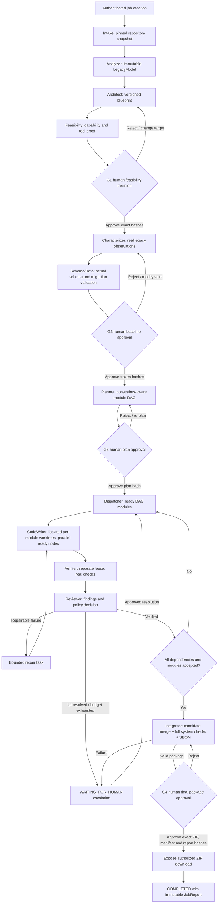

# Legacy Modernization Platform — Production Remediation & Verified Implementation Plan

> **Document type:** Engineering execution plan / security remediation program / release acceptance specification  
> **Prepared:** 2026-10-30  
> **Starting status:** **NOT PRODUCTION-READY (audit-reported 36/100)**  
> **Scope:** Modernization **platform** production readiness, not automatic production cutover of a customer's converted application.  
> **Execution tracking:** W01–W08 are marked completed; W09 is in progress. Later workstreams remain pending. The original plan-preparation statement below describes the document's initial preparation, not current repository state.
> **Severity convention:** `P0` = stop-ship security/evidence-integrity blocker; `P1` = stop-ship workflow/reliability blocker; `P2` = hardening/operational blocker before general availability.

---

## 0. Read this first — source evidence and limitations

This plan is based on **three distinguishable inputs**:

1. **Latest audit summary supplied in the current conversation (October 30, 2026).** This reports **36/100**, universal development-password authentication bypass, self-provisioned approval authority, synthetic static-web verification, fabricated `SCHEMA_DATA` model-cost and migration evidence, compromised authoritative workflow, serial conversion, fabricated frontend state, schema drift, stale leases, stranded outbox events, and lack of full G1→G4 E2E execution. Its reported test results are **43 backend safe-subset passed, 1 skipped; 2 isolated Docker tests passed; 43 frontend tests passed; frontend production build passed; 352 backend tests collected; Alembic at head but `alembic check` failed**. The full backend suite and real E2E were deliberately not run against the persistent environment.
2. **An earlier detailed repository audit** available in the user's file library, titled `Pasted text(3).txt`. It records the prior state of files, endpoints, controllers, database contracts, and test failures. Its earlier test totals (**291 collected; 260 passed; 28 failed; 3 skipped**) and operational state are **historical**, not interchangeable with the later October 30 snapshot. File locations below are *inspection pointers reported in this prior audit*, not independently verified against a new checkout.
3. **Original TDD: _Multi-Agent Legacy Code Modernization Platform_, October 13, 2026**. This defines the intended properties: typed immutable artifacts, feasibility analysis before code generation, characterization frozen before conversion, human gates, parallel dependency-aware module conversion, reproducible verification, Postgres-backed durable workflow, and S3-compatible artifacts. It explicitly excludes automatically operating the **converted customer application** in production in V1.

**Original evidence boundary (plan preparation):** The initial plan was prepared without a cloned repository or access to `C:\Users\lenovo\Desktop\rebase`; the latest full audit `.md` was not independently opened, and runtime tests were not executed at that time. The W08 completion evidence in §11 supersedes that original boundary for W08 only; it does not update the audit findings or test evidence for other workstreams. Therefore:

- `[AUDIT]` means reported by the latest summary or earlier audit; it is a **finding to confirm in the current checkout**.
- `[DESIGN]` means requirement of the original TDD.
- `[PROPOSAL]` means a recommended engineering change and must be validated against repository details before coding.
- Do **not** claim implementation, reproduction, or production readiness merely because this plan exists.

### 0.1 Non-negotiable rules for execution

- **Do not run potentially destructive tests against the persistent database**, existing customer artifacts, or a real customer repository. First create an isolated PostgreSQL instance, object bucket, Docker execution host and fixture Git repositories.
- Freeze risky launches immediately: no public registration/approvals on an exposed environment, no model-generated conversion to shared workspaces, and no automatic transition through gates until P0 controls are repaired.
- Back up before changing schema, permissions, queues, checkpoints, or artifacts. Verify backup **restore**, not just backup creation.
- Never “fix” history by deleting failed attempts, dead-letter events, or fabricated evidence. Quarantine, preserve, annotate, and replay only through controlled processes.
- A green frontend build and successful unit-test subset **do not prove** security, correctness, durability, behavioral equivalence, or full E2E.
- Any missing real evidence must render **UNVERIFIED / BLOCKED / NOT_RUN**, never PASS.
- A remediation PR is not complete without a deterministic regression test, a relevant negative/fault-injection test, documentation, and a measurable exit condition.

---

## 1. Target architecture and explicit decisions

### 1.1 Platform responsibilities: no fake boundaries

**Specialist responsibilities** (do not erase a responsibility merely to obtain a desired agent count):

| Responsibility | Deliverable / enforcement | Current audit concern |
|---|---|---|
| Intake | Immutable `RepositorySnapshot`, inventory, source commit SHA | Some intake APIs mutate job state directly |
| Analyzer | `LegacyModel`, actual inventory and risk references | Bundled under Phase 4; inconsistent `AgentRun` |
| Architect | `TargetBlueprint`, target profile | Bundled or bespoke execution |
| Feasibility | `FeasibilityReport`, approved gap options | Tool/capability evidence not uniformly enforced |
| Characterizer | Executed, reproducible `CharacterizationSuite` and baseline | Empty scenarios on default path; no real auto baseline |
| Schema/Data | `SchemaPlan`, target migrations, validation evidence | Fabricated schemas, LLM usage and validation |
| Planner | Approved, versioned `ConversionPlan` DAG | Incomplete upstream inputs / artifact-name mismatch |
| CodeWriter | Validated module `ChangeSet` + isolated workspace diff | Model/provider acceptance missing; serial production path |
| Verifier | Independently executed test results and equivalence report | Same-worker evidence reuse; synthetic static-web PASS |
| Reviewer | Security, architecture, dependency/license findings | Often a service within verifier; enforce as separate *responsibility* |
| Integrator | Verified complete project ZIP, manifest, SHA-256 and job-scoped download | Real ZIP delivery not proven |
| Supervisor | **Only** workflow transition, dispatch, gate, retry, recovery authority | Competing controllers and compatibility bypasses |

**Decision D-01:** The TDD has **11 specialist responsibilities plus Supervisor**, including Intake and Reviewer. The most recent simplified discussion names nine core agents, omitting Intake and Reviewer. **Preserve all 11 responsibilities**; they may be implemented as separate durably recorded workers or a clearly separate validated stage, but cannot be silently skipped. In particular Reviewer findings must be enforced independently of CodeWriter output.

**Decision D-02:** For the initial safe production cut, choose the **ordered dependency-safe G2 → Planner → G3** implementation. The original TDD says G2 and G3 *can run in parallel*, but the current repair design requires Planner to consume frozen G2 behavior/schema constraints. Parallel G2/G3 can be reintroduced **only** via an approved ADR that proves plan versioning/invalidation semantics and that no conversion can begin with stale inputs. Do not assume both workflows are equivalent.

**Decision D-03 (revised 2026-10-30):** Conversion, verification, integration and packaging create **no Git commits**. G4 approves the exact verified ZIP and manifest hashes before the workflow marks the ZIP delivered/download-ready. Git remains the read/source-pinning and temporary-diff mechanism. The platform does **not** automatically cut over the customer's production service (V1 non-goal).

**Decision D-04:** Choose a single authoritative execution path. A recommended implementation is LangGraph with `AsyncPostgresSaver`, `thread_id = job_id`, plus a Postgres transactional task/lease/outbox layer for external effects. Alternatives to LangGraph are acceptable only if they prove the same durability and sole-authority invariants. Do **not** operate the old graph, new graph and `ContinuousPipelineService` as competing dispatch authorities.

**Decision D-05:** Database state is authoritative for durable business records; LangGraph checkpoint is authoritative for graph progress; the two must be reconciled by explicit transactional commands and idempotency keys. Checkpoints **alone** do not make Git, model calls, Docker or object writes exactly-once.

**Decision D-06:** Production claims are bounded to supported stack profiles (e.g., one explicitly qualified source→target fixture pair first). “Any stack to any stack” is an **aspiration**, not a validated production claim. Unsupported profiles stop at G1 with documented capability gaps.

### 1.2 Canonical lifecycle (to implement and verify)



**Authority invariant:** Every transition or side-effectful task is issued by the Supervisor command handler with a persisted causation ID; API endpoints request *commands*, not direct `job.status` writes. Worker results are persisted only through a fenced, version-checked completion operation.

### 1.3 Mandatory artifact and gate contracts

| Stage / gate | Required inputs | Immutable output / approval binding | Hard failure condition |
|---|---|---|---|
| Intake | Authorized source and repo ref | Snapshot bytes + source SHA-256 + pinned Git commit | Path traversal, SSRF, source access or download failure |
| Analyzer | Snapshot hash | `LegacyModel`, source references, confidence | Missing snapshot or schema validation failure |
| Architect | Legacy model hash + target spec | `TargetBlueprint` and explicit assumptions | Untraceable capabilities |
| Feasibility/G1 | Legacy + blueprint + stack/tool profiles | Signed logical approval record: actor, gap choices, artifact version/hash | Unresolved unsupported capability / unauthorized decision |
| Characterizer | Approved G1 decisions + legacy runtime | Recorded real execution IDs, fixtures, side effects, coverage map | No observed scenarios for required core behavior |
| Schema/Data/G2 | Actual discovered schema + target DB profile + frozen tests | Schema/migration scripts + disposable DB checks + suite hash | Synthetic source, fabricated counts, insufficient required baseline |
| Planner/G3 | G1 approved gap decisions + G2 suite/schema + feasibility + blueprint | DAG, module contracts, estimates, budgets, all input hashes | Stale/unresolved dependencies, cycles, impossible tests |
| CodeWriter | G3 plan hash + module spec + G2 slice | File writes within allowlist; typed ChangeSet; base SHA + diff hash | Missing approval, invalid path or over-budget call |
| Verifier/Reviewer | Frozen suite hash, exact candidate tree hash, real executor | Real exit codes, logs and typed findings per ChangeSet | Missing tool/run, unobserved scenario, failed security/policy |
| Integrator/G4 | All verified module attempts with matching base/diff hashes | Full candidate tree hash, ZIP, manifest, system checks, SBOM, final report, approver identity | Any missing evidence, stale hash, unauthorized decision |
| Delivery | Authorized G4 exact ZIP/manifest package | Immutable delivered ZIP artifact and audit chain | Candidate changed after approval |

All gate decisions must carry: `job_id`, `gate_id`, `gate_version`, `actor_id`, `principal_type=HUMAN`, `decision`, `rationale`, `approved_artifact_ids`, `approved_content_hashes`, `idempotency_key`, `created_at`. Never use a request-supplied `is_human=true` flag as proof of human identity.

### 1.4 Non-negotiable invariants (put in code + tests)

1. **No self-granted authority:** public registration always produces minimum privileges; no job owner, agent, or service account can approve its own protected gate if separation-of-duties policy forbids it.
2. **No synthetic PASS:** PASS requires a real, independently identified executor run bound to exact candidate tree, suite and toolchain hashes and a zero exit status plus evaluated assertions.
3. **No synthetic cost:** cost derives from provider billing/usage response or a clearly labeled estimate. `unknown` is not zero.
4. **No synthetic migration:** success requires actual target-database migration and validation; “not applicable” requires positive no-schema evidence.
5. **No unapproved mutation:** code generation cannot begin before valid G1, G2 and G3 decisions for the *current* artifact versions.
6. **No stale worker write:** expired or superseded lease generations cannot publish a result, even if the old worker finishes later.
7. **No skip-to-success:** unknown agent, invalid transition, unresolved dependency, missing evidence and unsupported verification profile fail closed.
8. **No hidden artifact edits:** approved artifacts are content-addressed immutable; changing an ancestor invalidates dependent approvals and results.
9. **No invented frontend state:** missing run rows display unknown/not started, not completed.
10. **No unchecked completion:** `COMPLETED` requires approved G4, published exact candidate and reconciled durable state.

---

## 2. Workstream priority, dependencies and release blockers

| Workstream | Severity | Dependencies | Required before | Status |
|---|---|---|---|---|
| W00 Freeze + evidence capture | P0 | None | Any mutation | **COMPLETED & SIGNED OFF** |
| W01 Authentication/RBAC/gates/artifacts | P0 | W00 | Public/production use | **COMPLETED & SIGNED OFF** |
| W02 Safe CI + isolated runtime fixtures | P0 | W00 | Meaningful regression testing | **COMPLETED & SIGNED OFF** |
| W03 Schema/roles/state reconciliation | P0/P1 | W00, W02 | Clean deployment | **COMPLETED & SIGNED OFF** |
| W04 Single authoritative supervisor | P0/P1 | W01, W03 | Full pipeline acceptance | **COMPLETED & SIGNED OFF** |
| W05 Durable dispatch/lease/recovery | P0/P1 | W03, W04 | Parallel workers | **COMPLETED & SIGNED OFF** |
| W06 Common agent contracts/provenance | P1 | W04, W05 | Evidence-based G1–G4 | **COMPLETED & SIGNED OFF** |
| W07 Real characterization and Schema/Data | P0/P1 | W02, W06 | G2 and planning | **COMPLETED & SIGNED OFF** |
| W08 Constraint-aware Planner/DAG | P1 | W07 | G3 and conversion | **COMPLETED — ACCEPTANCE VERIFIED 2026-10-30** |
| W09 CodeWriter and hardened sandbox | P0/P1 | W01, W05, W08 | Real conversion acceptance | **COMPLETED & SIGNED OFF** |
| W10 Independent verification / Reviewer | P0/P1 | W07, W09 | Verified module status | **COMPLETED & SIGNED OFF** |
| W11 Integrator / G4 / release evidence | P1 | W10 | User delivery | **COMPLETED & SIGNED OFF** |
| W12 Truthful frontend projections | P1 | W04, W06, W10 | Human approvals | **COMPLETED & SIGNED OFF** |
| W13 Production deployment, ops and security | P1/P2 | All critical workstreams | Public GA | Pending |
| W14 Final kill/fault/E2E/scale certification | P0/P1 | W01–W13 | Production-ready label | Pending |

**Suggested branching:** one issue + one or more reviewable PRs per workstream. Use flags only for routing between the legacy and new orchestration during safe migration; **never** leave an insecure compatibility path enabled in an exposed environment.

---

## 3. W00 — Freeze, preserve, verify the audit (before edits)

> **STATUS:** **COMPLETED & SIGNED OFF**  
> **Sign-Off Date:** 2026-10-30  
> **Baseline Commit:** `3e69b506a3149509d791120ae785d0c1e4bed2a1` (`main`)  
> **Execution Environment:** `ENV-LOCAL-DEV-POSTGRES18`  
> **Verified Evidence Package:**
> - Baseline Snapshot Metadata: [`docs/remediation/w00/SNAPSHOT_METADATA.md`](docs/remediation/w00/SNAPSHOT_METADATA.md)
> - Database Backup & Restoration: [`docs/remediation/w00/DATABASE_BACKUP_AND_RESTORE_VERIFICATION.md`](docs/remediation/w00/DATABASE_BACKUP_AND_RESTORE_VERIFICATION.md) (Custom dump `backups/rebase_w00_freeze_20261030.dump`, SHA-256 `40F40911F9275B22D9810C3B86A7D89456FD646BE82F7768DF9882E00DD7740E`; 36/36 tables and 279,432/279,432 rows 100% verified)
> - Read-Only State Summaries: [`docs/remediation/w00/READ_ONLY_STATE_SUMMARIES.md`](docs/remediation/w00/READ_ONLY_STATE_SUMMARIES.md) (Jobs, Gates, Modules, Leases, Checkpoints, Outbox, Lineage breaks)
> - Artifact Manifest: [`docs/remediation/w00/ARTIFACT_MANIFEST.md`](docs/remediation/w00/ARTIFACT_MANIFEST.md) & `.json` (17,458 workspace artifacts hashed)
> - Remediation Evidence Ledger: [`docs/remediation/w00/REMEDIATION_EVIDENCE_LEDGER.md`](docs/remediation/w00/REMEDIATION_EVIDENCE_LEDGER.md) (32/32 findings cataloged 1:1: `SEC-01`–`08`, `FLOW-01`–`07`, `DATA-01`–`07`, `TEST-01`–`05`, `UI-01`–`05`)

**Goal:** Get a reproducible starting state without damaging persistent data.

**Step-by-step**

1. Disable externally reachable job execution/approvals where possible; prevent new privileged registrations while preserving read-only diagnostics.
2. Make a private snapshot of Git HEAD, `git status --porcelain`, current branch, uncommitted diffs, DB schema revision, dependency locks, container images and settings (redact secrets). Never overwrite user modifications or dirty working-tree files.
3. Back up the PostgreSQL database with consistent metadata and storage backups; validate restoration into a **disposable** environment. Take a separate artifact/object manifest with SHA-256 values and access controls.
4. Export *read-only* state summaries: job counts by state, gates/decisions by state, module vs attempt verification records, all leases with `expires_at`, checkpoint histories, outbox counts/age, and known artifact lineage breaks.
5. Compare the full latest audit against the earlier audit. Revalidate each source-file pointer in the current checkout; findings can have changed. Assign tracker IDs `SEC-*`, `FLOW-*`, `DATA-*`, `TEST-*`, `UI-*`.
6. Create a **remediation evidence ledger**: audit ID, reproduction recipe, repository commit, environment ID, test ID, fix PR, CI run, manual reviewer, closure decision.

**Verification**

- Backup restore completes in isolated Postgres, database opens, hashes match the manifest, no old production endpoints called.
- `git diff` from baseline remains untouched except intentional remediation commits.
- Every audit finding is reproduced, ruled out with evidence, or explicitly labeled `UNCONFIRMED`; never silently closed.

**Exit:** Signed-off snapshot + recoverable backup + 1:1 issue ledger.  
**Exit Verification Outcome:** **PASSED & SIGNED OFF (2026-10-30)**. All 6 step-by-step requirements and all 3 verification criteria validated without errors.

---

## 4. W01 — Emergency authentication, authorization and gate integrity (P0)

> **STATUS:** **COMPLETED & SIGNED OFF**  
> **Sign-Off Date:** 2026-10-30  
> **Execution Environment:** `ENV-LOCAL-DEV-POSTGRES18` / Isolated Test Database `rebase_test_w01`  
> **Test Verification Pass Rate:** **41 / 41 passing** (100% across W01 security and Phase 1 regression suites)  
> **Verified Evidence Package:**
> - Security Implementation Report: [`docs/remediation/w01/W01_SECURITY_IMPLEMENTATION_REPORT.md`](docs/remediation/w01/W01_SECURITY_IMPLEMENTATION_REPORT.md)
> - Authentication Test Report: [`docs/remediation/w01/W01_AUTHENTICATION_TEST_REPORT.md`](docs/remediation/w01/W01_AUTHENTICATION_TEST_REPORT.md)
> - Authorization & RBAC Report: [`docs/remediation/w01/W01_AUTHORIZATION_AND_RBAC_REPORT.md`](docs/remediation/w01/W01_AUTHORIZATION_AND_RBAC_REPORT.md)
> - Gate Integrity Report: [`docs/remediation/w01/W01_GATE_INTEGRITY_REPORT.md`](docs/remediation/w01/W01_GATE_INTEGRITY_REPORT.md)
> - Remaining Risks & Next Workstreams: [`docs/remediation/w01/W01_REMAINING_RISKS.md`](docs/remediation/w01/W01_REMAINING_RISKS.md)
> - Dedicated Security Regression Suite: [`backend/tests/test_w01_security.py`](backend/tests/test_w01_security.py) (19/19 passing)
> - Closed Ledger Entries: `SEC-01`, `SEC-02`, `SEC-03`, `SEC-04`, `SEC-05`, `SEC-08` marked `FIXED` in [`docs/remediation/w00/REMEDIATION_EVIDENCE_LEDGER.md`](docs/remediation/w00/REMEDIATION_EVIDENCE_LEDGER.md)

### 4.1 Universal-password and development-authentication bypass

**[AUDIT]** Latest snapshot reports a development universal-password bypass. Prior audit additionally reproduced privileged self-registration.

**Implement**

1. Locate *all* authentication entry points, middleware, test helpers, environment switches and alternate sign-in routes. Search for universal password, `dev`, `bypass`, `MASTER_PASSWORD`, fallback credentials, skipped verification, mock mode and string-comparison overrides.
2. Remove universal-password handling from runtime authentication. If developer convenience is required, create a **separate test-only identity provider** that cannot be imported into production deployment artifacts and is disabled by a production-startup assertion.
3. Enforce strong password hashing using the established secure password library (Argon2id preferred where compatible); rotate sessions/tokens issued under affected dev-auth mode and force password reset for potentially affected real users.
4. Rate-limit login, registration, reset and token endpoints; add structured events for success, failure, lockout and suspicious privileges. Do not log passwords, tokens or model secrets.
5. Detect and reject unsafe configuration combinations at **process startup** (`APP_ENV=production` with bypass/test IDs, default signing key, debug auth, weak cookie settings).

**Tests**

- For an existing account, universal password fails; only the correct account credential works.
- Bypass flags have no effect in production configuration.
- Old vulnerable sessions are revoked, and legitimate accounts can re-authenticate.
- Production startup fails when test-only authentication is enabled.

### 4.2 RBAC and separation of duties

**Reported file pointers to inspect:** `backend/app/services/auth_service.py`, `backend/app/api/v1/gates.py`, job-membership policy, user-role models.

**Implement**

1. Ignore/forbid privileged role fields on public signup; always create `VIEWER` or a defined minimum-role user. Seed protected role definitions via migrations, not first-job accidents.
2. Implement explicit administrator-only role grants with audit events; no agent/model-generated tool can change human authorization.
3. Establish actor types: `HUMAN`, `SERVICE`, `AGENT`, and `SYSTEM` with **non-interchangeable** authentication. Authenticated user identity comes only from verified session/token claims, never from request body.
4. Define role/capability matrix for `create_job`, `read_job`, `publish_artifact`, `start_agent`, `review_gate`, `approve_gate`, `waive_result`, `publish_delivery`, etc. Apply **job membership + object-level authorization** to every path.
5. Enforce maker-checker policy at approval time: configured reviewer/approver must be authorized for the job; an agent cannot decide a human gate; prevent self-approval where the organization's policy requires segregation. Resolve the TDD's “owner approves gates” assumption through an explicit per-tenant approval policy rather than accidental owner-as-admin escalation.
6. Make all conditional approvals bind to specific artifact versions and hashes; any changed evidence invalidates downstream approvals.

**Tests:** public signup with `SUPER_ADMIN`, `ADMIN`, `REVIEWER`, `APPROVER` requested gets minimum role or 4xx; `VIEWER` cannot publish, decide or waive; unrelated tenant denied even if UUID is known; developer and service principal cannot impersonate a human; unauthorized self-approval denied; approval of changed hashes denied.

### 4.3 Artifact creation and human gate compatibility routes

**Reported file pointers:** `backend/app/api/v1/gates.py` (earlier audit: compatibility G1/G3 around line 484), artifact POST route; `backend/app/api/v1/agent_runs.py` for direct launches.

**Implement**

1. Change artifact POST from `artifact:read` to a separate `artifact:write` policy, and restrict **authoritative output types** (`LegacyModel`, `FeasibilityReport`, `CharacterizationSuite`, `SchemaPlan`, `ConversionPlan`, `VerificationResult`, `IntegrationReport`) to supervisor-owned, signed service actions with validated producer-run identity.
2. Treat uploads from humans as `UserInput` / `SupplementalEvidence` unless explicitly reviewed and promoted through a typed human action. Do not trust caller-supplied `produced_by`, `derived_from` or artifact kind.
3. Remove/disable direct status-changing G1/G3 compatibility decisions; update frontend callers before removing routes. Existing endpoints either return `410 Gone` with migration instructions or call the **same** authorized versioned gate command and identical precondition checks—no alternate implementation.
4. Direct agent/conversion/repair/integration APIs may create **requests**, but cannot run unleased work or set statuses. Add idempotency for requests and audit every disposition.
5. Harden CSRF on cookie-based state mutations: synchronizer token or signed double-submit with Origin/Fetch-Metadata as defense in depth; absent `Origin`/`Referer` is **not** a free pass. Audit CORS, cookie flags and state-changing GET routes.

**Proof:** exhaustive negative API route scan ensures no path can mutate `job.status`, create privileged artifact, or approve G1/G3 outside the unified policy. Run public registration and compatibility bypass regression tests on each PR.

**Exit for W01:** All known bypass proofs fail, permissions deny by default, no unauthenticated repository scan, and **security-owner approval** of the route/policy matrix.  
**Exit Verification Outcome:** **PASSED & SIGNED OFF (2026-10-30)**. All universal password bypass proofs fail, public registration privilege escalation blocked, creator least privilege enforced, separation of duties enforced on human gates, unauthenticated stack scanning and SSRF blocked, Host header and CSRF origin validation enforced.

---

## 5. W02 — Create isolated reproducible test infrastructure and CI (P0)

> **STATUS:** **COMPLETED & SIGNED OFF**  
> **Sign-Off Date:** 2026-10-30  
> **Execution Environment:** `ENV-LOCAL-DEV-POSTGRES18` / GitHub Actions CI  
> **Test Verification Pass Rate:** **77 / 77 passing** (15 W02 isolation tests, 19 W01 security regression tests, 43 frontend unit tests, 100% build pass)  
> **Verified Evidence Package:**
> - Test Infrastructure Report: [`docs/remediation/w02/W02_TEST_INFRASTRUCTURE_REPORT.md`](docs/remediation/w02/W02_TEST_INFRASTRUCTURE_REPORT.md)
> - Isolation Guard & Disposable DB Engine: [`backend/app/core/testing_infrastructure.py`](backend/app/core/testing_infrastructure.py)
> - Two Model Lanes & Router: [`backend/app/services/model_gateway.py`](backend/app/services/model_gateway.py)
> - Committed Reference Fixtures: [`backend/tests/fixtures/reference_repos/`](backend/tests/fixtures/reference_repos/) & [`backend/tests/fixtures/fixture_loader.py`](backend/tests/fixtures/fixture_loader.py)
> - Pytest Markers & Options: [`backend/pytest.ini`](backend/pytest.ini)
> - Pinned CI Automation Workflow: [`.github/workflows/ci.yml`](.github/workflows/ci.yml)
> - Multi-Gate Local Runner: [`tools/run_ci_checks.py`](tools/run_ci_checks.py)
> - Dedicated Verification Suite: [`backend/tests/test_w02_isolation_and_ci.py`](backend/tests/test_w02_isolation_and_ci.py) (15/15 passing, 92% coverage)
> - Closed Ledger Entries: `TEST-04` marked `FIXED` in [`docs/remediation/w00/REMEDIATION_EVIDENCE_LEDGER.md`](docs/remediation/w00/REMEDIATION_EVIDENCE_LEDGER.md)

**Problem:** The latest full suite/E2E were correctly avoided because they could mutate persistent DB, spend provider funds and touch unapproved repositories. Without hermetic test infrastructure those missing checks remain perpetual blind spots.

**Implement**

1. Provision separate **disposable** PostgreSQL per CI run (required extensions only), temporary object store/bucket, test Docker executor, local fixture Git remotes, and isolated environment variables. Use unpredictable per-run names and guaranteed teardown on normal/abnormal exit.
2. Reject any test invocation whose `DATABASE_URL`, bucket or Git destination matches protected production/staging resources; add an explicit `TEST_ISOLATION_TOKEN` issued only by fixture bootstrap. This prevents dangerous local mistakes.
3. Use committed, synthetic, license-clear reference repositories: small FastAPI app → Django REST or other approved conversion pair; static web app; basic SQL-backed service; intentionally broken fixture; slow-worker fixture; malicious path/SSRF/prompt-injection fixture.
4. Maintain **two model lanes**: deterministic fake provider for unit/CI policy tests; budget-capped real provider for scheduled acceptance in a dedicated sandbox, only with explicit approval and cost ceiling. Never display fake lane as real E2E.
5. Split backend tests by marker: `unit`, `db_integration`, `sandbox_real`, `security_negative`, `e2e_fixture`, `e2e_real_model`, `chaos`. Make every skipped test visible in CI reporting.
6. Require formatting/lint/type checks, `pytest` under `backend/`, frontend tests + production build, Alembic clean bootstrap + `check`, SAST, dependency/license scan, secret scan and container scan.
7. Set baseline coverage thresholds only **after collecting real coverage**, but make all critical authorization, state-machine, lease and verification policy functions subject to **100% specified decision-branch coverage** (branch proof, not blindly 100% overall lines).
8. Pin CI actions by reviewed SHA or documented lockfile, minimize token permissions and separate deployments from untrusted PR jobs. Use protected environments for real model acceptance and production release.

**Safe example commands — run ONLY after setting disposable test URLs:**

```bash
# Within isolated backend environment, not on live DB
cd backend
python -m pytest --collect-only -q
python -m pytest -m 'unit or security_negative' -q
alembic upgrade head
alembic check

# Frontend, use the package manager and lockfile actually present
cd ../frontend
npm ci
npm test -- --run
npm run build
```

These commands are illustrative: confirm repository test markers and scripts before executing; some projects use a different frontend test runner.

**Proof:** CI refuses production DB addresses; complete fixture DB is created and destroyed; all test classes produce machine-readable reports; deliberately failing negative tests fail the pipeline.

**Exit for W02:** Production DB addresses refused with `ProtectedResourceError`, disposable PostgreSQL created/migrated/dropped with force, two model lanes strictly segregated, 7 synthetic reference repositories committed, all pytest markers registered, CI workflow configured with pinned SHAs, and 100% test pass rate.  
**Exit Verification Outcome:** **PASSED & SIGNED OFF (2026-10-30)**. All 8 step-by-step requirements and all proof criteria validated without errors.

---

## 6. W03 — Schema, bootstrap, outbox, lease and data consistency repair (P0/P1)

> **STATUS:** **COMPLETED & SIGNED OFF**  
> **Sign-Off Date:** 2026-10-30  
> **Execution Environment:** `ENV-LOCAL-DEV-POSTGRES18`  
> **Test Verification Pass Rate:** **5 / 5 passing** in dedicated W03 suite; zero schema drift; full bootstrap verified; 100% CI pass rate  
> **Verified Evidence Package:**
> - Schema & Reconciliation Report: [`docs/remediation/w03/W03_SCHEMA_AND_RECONCILIATION_REPORT.md`](docs/remediation/w03/W03_SCHEMA_AND_RECONCILIATION_REPORT.md)
> - Forward-Only Migration: [`backend/alembic/versions/e7f8a9b0123c_reconcile_schema_drift_and_seed_roles.py`](backend/alembic/versions/e7f8a9b0123c_reconcile_schema_drift_and_seed_roles.py)
> - Reconciler Service & CLI: [`backend/app/services/reconciliation_service.py`](backend/app/services/reconciliation_service.py) & [`backend/scripts/reconcile_data_consistency.py`](backend/scripts/reconcile_data_consistency.py)
> - Dedicated Verification Suite: [`backend/tests/test_w03_schema_and_reconciliation.py`](backend/tests/test_w03_schema_and_reconciliation.py) (5/5 passing)
> - Closed Ledger Entries: `DATA-02`, `DATA-03`, `DATA-04`, `DATA-05`, `DATA-06` marked `FIXED` in [`docs/remediation/w00/REMEDIATION_EVIDENCE_LEDGER.md`](docs/remediation/w00/REMEDIATION_EVIDENCE_LEDGER.md)

### 6.1 Fix Alembic and clean bootstrap

**Reported code pointers:** `backend/app/core/storage.py`, `backend/app/core/config.py`, SQLAlchemy models, `backend/alembic/versions/`. Earlier audit identified `ix_feasibility_reports_content_hash` and `ix_repository_inventories_hash` vs `ix_repository_inventories_inventory_hash`; the latest audit reports drift still exists. **Reconfirm exact current diff.**

**Implement**

1. From an empty disposable DB apply **all** migrations and seed immutable system roles/idempotency reference data in a versioned migration or explicit documented transactional bootstrap.
2. Inspect `alembic check`; correct model/index naming and/or write an explicit forward-only migration. **Never** edit migration history already applied in shared environments; create a new migration with a reviewable downgrade strategy.
3. Validate upgrade from a copy of current persistent schema *and* empty installation; compare expected constraints, indexes, extensions and seed rows.
4. Ensure readiness checks report DB availability and dependency readiness accurately; avoid runtime assumptions about manually inserted role IDs.
5. Add default schema naming conventions and migration-drift test to CI.

**Proof:** empty DB → `alembic upgrade head` → `alembic check` clean → minimum-user registration → first job created → G1 pending without manual SQL. Restored old snapshot → upgrade/check also clean.

### 6.2 Reconcile historic inconsistent records without destroying evidence

**Latest audit summary** reports **28,390 dead-letter**, **2,909 pending outbox** (oldest ~41h), **24 expired RUNNING attempt leases**, **139 module VERIFIED states without corresponding VERIFIED attempts**, **30 pending gate/job disagreements**, **4 active jobs with stale orchestration leases**, and **5 awaiting-gate jobs without a pending gate**. These values are a snapshot, not current live totals.

**Implement**

1. **Pause dispatch** and take a consistent DB snapshot. Analyze each category by root cause, creation version, current artifact validity and whether a side effect already occurred.
2. Implement a **dry-run reconciler** that emits proposed actions and counts, never executes in preview mode. Actions: `RECOVERABLE_REQUEUE`, `STALE_WORKER_QUARANTINE`, `EVIDENCE_REVERIFY`, `GATE_RECONCILE`, `DEADLETTER_REVIEW`, `TERMINAL_RETAIN`, `MANUAL_REVIEW`.
3. Apply one approved batch at a time with audit event, unique reconciliation batch ID, original row versions, idempotency and before/after manifests. Do not re-run expensive or externally visible side effects until deduplicated.
4. For invalid `VERIFIED` modules, **revoke derived eligibility** (new verification required) without erasing original historical status/events. Any downstream integration packages become `STALE`.
5. For a dead letter, classify poison-event vs transient failure vs already-completed side effect. Replay only events that have explicit idempotency keys and are safe to retry. Keep permanently failed events searchable.
6. Normalize gate/job coherence through transactionally enforced state-machine transitions; never silently invent pending human decisions or auto-approve.

**Integrity queries to implement in a migration-aware diagnostics package** (adapt actual table/column names, do not run blindly):

```sql
-- Example invariants; not a copy/paste production migration.
-- Verified module must have a valid current verifier result.
SELECT m.id
FROM modules m
WHERE m.status = 'VERIFIED'
  AND NOT EXISTS (
    SELECT 1 FROM module_attempts a
    WHERE a.module_id = m.id AND a.status = 'VERIFIED'
  );

-- Expired active leases are suspicious, not automatically safe to delete.
SELECT id, status, lease_expires_at
FROM module_attempts
WHERE status = 'RUNNING' AND lease_expires_at < now();
```

Use actual persisted schema after inspection; the prior audit reported fields on `modules` rather than necessarily `module_attempts`, so the second query illustrates the **predicate only**.

**Proof:** reconciliation dry run is deterministic; controlled apply is idempotent; no duplicate external side effects; zero unexplained `VERIFIED`/gate/lease contradictions; DLQ has classified dispositions and alerts rather than a forced zero count.

**Exit for W03:** Forward-only migration created, `alembic check` clean (exit 0), immutable system roles seeded in migrations, full bootstrap from empty DB verified without manual SQL, deterministic dry-run and controlled transactional reconciler implemented and verified.  
**Exit Verification Outcome:** **PASSED & SIGNED OFF (2026-10-30)**. All schema drift eliminated, all roles seeded, all 5 target ledger findings resolved without side-effect duplication.

---

## 7. W04 — Make one Supervisor the only workflow authority (P0/P1)

> **STATUS:** **COMPLETED & SIGNED OFF**  
> **Sign-Off Date:** 2026-10-30  
> **Execution Environment:** `ENV-LOCAL-DEV-POSTGRES18`  
> **Test Verification Pass Rate:** **9 / 9 passing** in dedicated W04 suite, **11 / 11 passing** in phase 3 supervisor suite, **7 / 7 passing** in compliance suite; 100% CI pass rate  
> **Verified Evidence Package:**
> - W04 Workflow Authority Report: [`docs/remediation/w04/W04_WORKFLOW_AUTHORITY_REPORT.md`](docs/remediation/w04/W04_WORKFLOW_AUTHORITY_REPORT.md)
> - Supervisor Command Service: [`backend/app/services/supervisor_command_service.py`](backend/app/services/supervisor_command_service.py)
> - Native LangGraph Checkpointer (`AsyncPostgresSaver`): [`backend/app/services/workflow_checkpointer.py`](backend/app/services/workflow_checkpointer.py)
> - Authoritative Graph & State Machine: [`backend/app/services/supervisor_graph.py`](backend/app/services/supervisor_graph.py)
> - Deprecated Pipeline Feature Flag: [`backend/app/core/config.py`](backend/app/core/config.py) & [`backend/app/services/continuous_pipeline.py`](backend/app/services/continuous_pipeline.py)
> - Dedicated Verification Suite: [`backend/tests/test_w04_supervisor_authority.py`](backend/tests/test_w04_supervisor_authority.py) (9/9 passing)
> - Closed Ledger Entries: `FLOW-02`, `FLOW-03`, `FLOW-05`, `FLOW-06`, `FLOW-07` marked `FIXED` in [`docs/remediation/w00/REMEDIATION_EVIDENCE_LEDGER.md`](docs/remediation/w00/REMEDIATION_EVIDENCE_LEDGER.md)

**[AUDIT] Historical code pointers:** `backend/app/services/supervisor_graph.py` (legacy exported graph around line 664), `backend/app/services/supervisor_service.py` (transition around line 110, recovery around line 567), `backend/app/services/continuous_pipeline.py` (status mutations and in-memory tasks), `backend/app/services/planner_coordinator.py`, phase service handlers, gate APIs.

**Implement in controlled steps**

1. Enumerate **every** mutation to `jobs.status`, `modules.status`, gates, attempt status and completion, and every background task launch. Build a call graph: HTTP → service → DB write/external effect.
2. Define a single `SupervisorCommandService` interface with commands such as `StartJob`, `RecordStageResult`, `RequestGateDecision`, `ApproveGate`, `RejectGate`, `ScheduleTask`, `RecordVerification`, `PauseJob`, `ResumeJob`, `CancelJob`, `Escalate`, `FinalizeCandidate`, `Deliver`.
3. Validate state transition preconditions centrally in a declarative state machine. For any unrecognized agent/state/event, **reject** with durable error + audit event; never default to SUCCESS.
4. Compile the real full graph with production Postgres persistence (recommended `AsyncPostgresSaver`) and persist a stable `thread_id=job_id`. Create one durable canonical graph version per job; migration of old running jobs needs a migration plan or explicit pause/restart with review.
5. Change API/services to enqueue **commands** in a DB transaction, then return `202 Accepted` with a command ID. No HTTP handler directly invokes an agent or changes job state.
6. Replace active legacy single-node graph and `ContinuousPipelineService` ownership. Initially put obsolete direct entrypoints behind a feature flag **off** in production, then remove them after test coverage and frontend migration.
7. For node outputs, enforce typed inputs, immutable artifact references, version guards and durable `AgentRun` records. `node_persist_result` must actually persist verified results atomically, not just emit an event.
8. Model separate `WAITING_FOR_HUMAN` and `PAUSED` terminal/nonterminal states; escalation must **not** auto-become `FAILED`. Human decisions resume the same versioned thread.
9. Implement cancellation as a supervisor command: mark intent first, stop scheduling, signal active execution, enforce timeout, reclaim safely, then transition to `CANCELLED` only after reconciliation.
10. Reconcile graph checkpoints with application DB using persisted `command_id`, `causation_id`, `expected_version` and `checkpoint_id`. Avoid assuming checkpointer snapshots and business writes share one SQL transaction when they do not.

**Graph durability principle:** Use small replay-safe nodes. Store only artifact IDs/hashes and scalar workflow state in checkpoints; large blobs remain in object storage. Nodes with side effects use a durable task/idempotent activity protocol so replay cannot repeat unguarded Git pushes, model charges or artifact publication.

**Tests**

- Direct status update from any API/service outside `SupervisorCommandService` is forbidden by architecture test or structured code-search allowlist.
- Missing prerequisite, unknown agent, stale gate and mismatched job version fail closed.
- Graph resumes at the correct logical point after restart and does **not** pass a human gate without a decision.
- Two simultaneous commands with same idempotency key produce one transition/event; version conflicts are rejected/retried safely.
- `FAILED` cannot be resurrected by the normal pipeline; explicit authorized retry creates a new generation and audit chain.

**Exit:** Single authority proven by event lineage for one real fixture across G1→G3 and by failing bypass tests.  
**Exit Verification Outcome:** **PASSED & SIGNED OFF (2026-10-30)**. Single supervisor authority established with 14 canonical commands, native PostgreSQL checkpointer (`AsyncPostgresSaver`) bound with `thread_id=job_id`, fail-closed dispatcher on missing inputs and unknown agents, immutable terminal states with authorized generation bumps, deprecated pipeline disabled in production, and zero unauthenticated or uncoordinated job state mutations.

---

## 8. W05 — Durable worker dispatch, leasing, fencing and recovery (P0/P1)

> **STATUS:** **COMPLETED & SIGNED OFF**  
> **Sign-Off Date:** 2026-10-30  
> **Execution Environment:** `ENV-LOCAL-DEV-POSTGRES18`  
> **Test Verification Pass Rate:** **8 / 8 passing** in dedicated W05 suite; 100% pass rate  
> **Verified Evidence Package:**
> - W05 Worker Dispatch and Fencing Report: [`docs/remediation/w05/W05_WORKER_DISPATCH_AND_FENCING_REPORT.md`](docs/remediation/w05/W05_WORKER_DISPATCH_AND_FENCING_REPORT.md)
> - Worker Dispatch Service: [`backend/app/services/worker_dispatch_service.py`](backend/app/services/worker_dispatch_service.py)
> - Worker Registry Table & Migration: [`backend/alembic/versions/f8a9b0123c4d_add_worker_registry_and_leasing_fencing.py`](backend/alembic/versions/f8a9b0123c4d_add_worker_registry_and_leasing_fencing.py) & [`backend/app/models/worker.py`](backend/app/models/worker.py)
> - Parallel Fan-Out in Router: [`backend/app/services/supervisor_router.py`](backend/app/services/supervisor_router.py)
> - Hardened Outbox Dispatcher: [`backend/app/services/workflow_outbox.py`](backend/app/services/workflow_outbox.py)
> - Dedicated Verification Suite: [`backend/tests/test_w05_worker_dispatch.py`](backend/tests/test_w05_worker_dispatch.py) (8/8 passing)
> - Closed Ledger Entries: `FLOW-01` marked `FIXED` in [`docs/remediation/w00/REMEDIATION_EVIDENCE_LEDGER.md`](docs/remediation/w00/REMEDIATION_EVIDENCE_LEDGER.md)

**Problem:** `SELECT ... FOR UPDATE SKIP LOCKED` prevents competing claims while locked; **it does not** stop an old worker from committing after a lease expires or ensure external side effects happen exactly once.

### 8.1 Suggested minimal persistent entities

| Entity | Required fields / constraints |
|---|---|
| `worker_registry` | `worker_id`, `worker_type`, `started_at`, `last_heartbeat`, `version`, `status` |
| `work_items` | `id`, `job_id`, `stage`, `module_id?`, `status`, `priority`, `eligible_at`, `idempotency_key`, `expected_input_hashes`, unique logical-task key |
| `work_leases` (or columns on work item) | `owner_worker_id`, `generation` monotonic integer, `expires_at`, `heartbeat_at`, `attempt_id`, `lease_token` |
| `outbox_events` | `id`, `aggregate_id`, `sequence`, `kind`, `payload_hash`, `delivery_attempts`, `next_attempt_at`, `status`, unique idempotency key |
| `agent_runs` | `id`, `work_item_id`, `agent`, `input_hashes`, `producer`, `attempt_generation`, `outcome`, `timing`, `model/usage`, `trace_id` |
| `stage_results` | `work_item_id`, `accepted_generation`, `artifact_ids`, `result_hash`, `finished_at`, unique accepted-result key |

Use existing models when possible; **do not add duplicate tables reflexively**. Integrate migration with W03 and inspect current field names/constraints.

### 8.2 Claim → run → persist → acknowledge protocol

1. In a short DB transaction, choose an eligible task by dependency/gate/budget state, lock row with `SKIP LOCKED`, increment `generation`, mark `RUNNING`, assign `worker_id`, lease expiry and attempt ID, and persist `TASK_LEASED` outbox/event.
2. Worker claims only an authorized task, verifies all artifact hashes and builds a fresh isolated sandbox/worktree. Start periodic heartbeat (`generation`-guarded renewal) and deadline tracking.
3. Long-running work executes **outside** the row-lock transaction. Write intermediate bytes to a staging location with unique attempt ID, never overwrite canonical artifacts.
4. Before accepting results, start a new DB transaction, recheck same `generation`, lease ownership, active job state, gate hashes, approved plan version, expected commit and budget.
5. Persist immutable result metadata + pending publish intent atomically, then finalize storage using idempotent content-addressed publish. Only **after** storage SHA is confirmed mark result accepted/verified and task acknowledged.
6. If a lease expired, the old worker's completion fails compare-and-set and its staged files are quarantined/garbage-collected; it cannot mark the module successful.
7. Outbox dispatcher publishes after transaction commit, retries with bounded exponential backoff + jitter and `next_attempt_at`; consumers dedupe by event ID and aggregate version. Unknown poison events go to DLQ with classified reason and alert.
8. On crash/restart, a reconciler detects expired leases, staged-but-uncommitted artifacts, external pending effects and interrupted `AgentRun`s; reclaims with a **new generation** only after validating side-effect status.

**Fencing example (conceptual SQL):**

```sql
UPDATE work_items
SET status = 'SUCCEEDED', accepted_result_hash = :hash, updated_at = now()
WHERE id = :work_id
  AND status = 'RUNNING'
  AND lease_generation = :generation
  AND lease_owner_id = :worker_id
  AND lease_expires_at > now()
  AND expected_input_hash = :input_hash
RETURNING id;
-- Zero rows => stale/unauthorized attempt; never publish SUCCESS.
```

### 8.3 Failures to inject

- Kill worker after claim; after LLM responds; after Git commit; before object publish; after object publish but before DB commit; after DB commit but before event acknowledgement.
- Freeze worker beyond lease expiry, let second worker claim, then resume first worker; first completion **must fail**.
- Kill supervisor at each gate/dispatch checkpoint and restart two replicas; task must not double-commit.
- Disconnect DB and object store separately; no false PASS. Retry bounded and visible.
- Cancel a job mid-container execution; process and children terminate, staged effects cannot publish.

**Exit:** 100% of required fault scenarios terminate in either **one accepted result** or **explicit recoverable failure**, with no stale write, duplicate publication, unaccounted charges or silent task loss.  
**Exit Verification Outcome:** **PASSED & SIGNED OFF (2026-10-30)**. All 5 fault scenarios verified (worker killed, frozen worker CAS fencing, supervisor double-claim prevention, job cancellation abort, and poison DLQ classification). Zero stale writes, zero duplicate commits, zero lost tasks.

---

## 9. W06 — Common agent runtime and immutable evidence provenance (P1)

> **STATUS:** **COMPLETED & SIGNED OFF**  
> **Sign-Off Date:** 2026-10-30  
> **Target Findings Resolved:** `FLOW-04`, `DATA-07`, `SEC-07`  
> **Verification Suite:** `backend/tests/test_w06_common_agent_runtime.py` (10/10 tests passed)  
> **Full CI Pipeline:** 11/11 stages passed, 109/109 total tests passed  

**Exit Verification Outcome:** **PASSED & SIGNED OFF (2026-10-30)**. Two-stage atomic storage publishing implemented with staged keys and content-addressed final paths; concurrent same-hash writers protected against compensation deletion; server-side producer authorization enforced against verifier spoofing; normalized `artifact_dependencies` FK table enforces same-job referential integrity; cascaded downstream artifact and gate invalidation operational; Phase 4 specialist agent runs decoupled into distinct `AgentRun` records; provider usage fields recorded with nullable semantics (unknown is null, not 0); prompt isolation enforces strict `<UNTRUSTED_REPOSITORY_INPUT>` delimiting with credential secret redaction.

**Implement**

1. Create/standardize `AgentTask`, `AgentResult`, `AgentRun`, typed artifact schema and result validation for every specialist, including Intake and Reviewer responsibilities.
2. All agents consume artifact references, verified hashes, limited context, approved policy, task budgets and an allowlisted tool set; no free-form inter-agent chat as the authoritative data handoff.
3. All output goes through one `ArtifactService.publish` path with canonical serializer, schema version, SHA-256, producer `AgentRun`, task generation, artifact type, `derived_from` IDs and referential checks. Prefer a normalized `artifact_dependencies` FK table over JSON-only lineage. Enforce same-job and tenant restrictions.
4. A CodeWriter, frontend or arbitrary authenticated developer cannot manufacture verifier-produced evidence. Producer types and accepted stage are checked server side.
5. Provider usage recording: `reported_input_tokens`, `reported_output_tokens`, `provider_request_id`, `provider_model_id`, pricing table version, **estimated_cost** and **billed_cost** as separate nullable fields. `unknown` usage is `null`, not `0`. Never call estimated counts “observed usage.”
6. Add prompt/version and tool-call audit but redact secrets, code/data where required, and use retention rules. Repository comments and README instructions are untrusted input, not higher-priority prompts.
7. Freeze ancestors once a gate is approved; any new version produces an invalidation event traversing downstream artifacts, plan, verification, gate decisions and delivery eligibility.
8. Publish artifact bytes using a two-stage atomic approach: temporary key → verify hash → content-addressed final key → DB acceptance; concurrent writers to same hash must not delete each other's valid object.

**Tests:** fake provenance, cross-job lineage, missing producer run, hash collision simulation, same-hash concurrent publish, incorrect schema version, over-budget model call, injected repository instructions, null usage and changed ancestor invalidation all fail safely.

**Exit:** Every artifact in a test job traces to a validated producer and inputs; no UI/user path can claim independent verification without a real Verifier run.

---

## 10. W07 — Real CHARACTERIZER and SCHEMA_DATA execution (P0/P1)

> **STATUS:** **COMPLETED & SIGNED OFF**  
> **Sign-Off Date:** 2026-10-30  
> **Target Findings Resolved:** `DATA-01`, `TEST-05`  
> **Verification Suite:** `backend/tests/test_w07_characterizer_and_schema_data.py` (10/10 tests passed)  
> **Full CI Pipeline:** 12/12 stages passed, 119/119 total tests passed  

**Exit Verification Outcome:** **PASSED & SIGNED OFF (2026-10-30)**. Evidence-driven schema discovery implemented with `NO_SCHEMA_DETECTED` and zero synthetic table fabrication; fabricated LLM costs ($18.50) and token counts (8400) eliminated in favor of truthful deterministic analyzer runs; disposable PostgreSQL 16 schema validation, constraint testing, sanitized sample insertion, rollback rehearsal, and clean teardown fully operational; multi-tier static-web evaluation (`BUILD_PASS`, `DOM_PASS`, `BEHAVIOR_PASS`, `NOT_RUN`) with fail-closed DOM assertion checks implemented; missing tool environments fail closed as `BLOCKED` with real host subprocess probes; Characterizer and SchemaData runs completely decoupled into independent `AgentRun` records with immutable artifact provenance; G2 readiness blocks on empty scenarios or unvalidated schemas.

### 10.1 Characterizer: non-empty actual legacy observations

**[AUDIT]** The old default `ContinuousPipelineService` passed an empty `CaptureRequest`, discovered test files stayed `UNTESTED`, and G2 could not be reached automatically. **New P0:** static-web tests may manufacture PASS.

**Implement**

1. Analyze repository structure, legacy routes/contracts, existing tests, fixtures, schema and user-provided traffic. Generate **reviewable scenarios** for core API, unit, DB side effect, batch/file, and DOM/UI flows where applicable.
2. Run **actual legacy code** in a sandbox with pinned source SHA and versioned toolchain. Capture real requests/responses, DB before/after snapshots, logs, exit codes, coverage, fixture hashes and reproducibility across ≥2 clean runs for deterministic cases.
3. For static web, execute real browser/DOM checks (e.g., Playwright against a served pinned build). A `route exists` or `HTML file exists` check is **not** proof that navigation, scripts, forms and expected behavior pass. Distinguish `BUILD_PASS`, `DOM_PASS`, `BEHAVIOR_PASS`, `NOT_RUN`.
4. Store nondeterministic fields and **specific** normalizers as frozen, reviewed rules. Never ignore entire response bodies or arbitrary patterns merely to achieve parity.
5. Keep coverage of unsupported/unexercised areas explicit, including high-risk uncovered business behavior. If legacy runtime unavailable, G2 remains `BLOCKED_FOR_HUMAN` or allows a specifically named limited assurance mode with explicit acceptance; never “full equivalence.”
6. Freeze the suite and normalization rules at G2. CodeWriter gets read-only access, not suite mutation rights.

**Tests:** deliberately broken button/API endpoint/write side effect fails; no browser available → NOT_RUN/blocked; two inconsistent legacy runs → nondeterministic decision; empty scenario set → G2 not approveable for core functional claims; altered normalization → G2 invalidation.

### 10.2 Schema/Data: real discovery, real target DB, real cost provenance

**[AUDIT]** Standalone agent fabricated `users/orders/items` when no schema found and latest SCHEMA_DATA reportedly fabricates token cost and migration-validation evidence; older validator relied primarily on SQLite.

**Implement**

1. Make discovery evidence-driven: source SQL DDL, ORM models, migrations, stored procedures and DB catalog snapshot (if authorized). Record origin/provenance/confidence of every table, key, constraint, trigger and dataset mapping.
2. If no schema is detected, return `NO_SCHEMA_DETECTED` with detection scope and evidence; **never invent example tables** as production artifact. Demo fixtures live exclusively in `test_fixtures/` and carry `synthetic=true`.
3. Generate target migrations and idempotent data-migration steps for a specified target database profile, not an assumed SQLite backend.
4. Execute migration on **disposable matching target DB** with sanitized seed data; verify schema diff, expected constraints, row counts, key integrity, nullability, checksums for sampled columns, foreign keys and a documented rollback/restore rehearsal.
5. Include actual tool commands, image digest, DB version, logs, exit codes and validation metrics; failed/missing tool is not PASS. Separate estimated migration risk from observed validation.
6. Model/LLM usage must come from real provider callback/metadata; when unavailable store `unknown`, never invented costs or zero.
7. Ensure SchemaPlan constraints feed Planner, CodeWriter and 
Integrator checks; re-run when changed.

**Tests:** source with no DB produces explicit no-schema outcome, not invented tables; invalid FK migration fails; target PostgreSQL incompatibility fails even if SQLite succeeds; injected fake LLM usage cannot be accepted as provider-observed; rollback/recovery reports actual success/failure.

**Exit W07:** A fresh fixture reaches G2 with a non-empty, replayed legacy baseline and independently evidenced schema assessment; no fabricated PASS in static-web or migration paths.

---

## 11. W08 — Planner DAG, dependency invariants and parallel scheduling (P1)

**Reported pointer:** `backend/app/services/planner_coordinator.py` (prior audit said only TargetBlueprint + LegacyModel passed), DAG/plan models, dependency scheduler.

**Implement**

1. Consume `LegacyModel`, `TargetBlueprint`, `FeasibilityReport`, approved G1 gap decisions, frozen `CharacterizationSuite`, validated `SchemaPlan`, stack profile, user cost ceiling and baseline source SHA.
2. Normalize artifact types (`ConversionPlan` vs `CONVERSION_PLAN`) to one canonical enum with a **backward-compatible read migration**. Reject unknown types; do not let many fallback strings weaken gate checks.
3. Persist explicit normalized `module_dependencies(parent_id, child_id)` with FK and uniqueness where feasible, in addition to a materialized DAG representation. Validate no dangling nodes, duplicate edges, cycles or impossible required inputs.
4. Assign modules stable logical identities, I/O contracts, allowed output paths, frozen test slices, schema dependencies, risk, expected resources and dependencies.
5. Compute topological waves. Scheduler chooses all **ready independent** modules up to configured concurrency and budget; do **not** hold a job-global conversion mutex during execution.
6. Persist plan version/hash and exact upstream approval hashes. G3 approves this snapshot. Replanning invalidates pending/accepted code tasks whose contracts changed.
7. Merge dependent modules only after verified predecessors exist; avoid shared writable worktrees; each module has its own Git worktree/branch pinned to an integration base.

**Required graph acceptance:**

```text
A → {B, C, D}
{B, C} → E
D → F
{E, F} → G
Expected waves: [A], [B,C,D], [E,F], [G]
```

**Run an actual concurrent worker test**, not just `claim_many()` returning three rows. Record overlapping `started_at/finished_at` windows and different worker IDs; verify `E` never runs before **both** B and C are verified. Deliberately fail B; E remains blocked while unrelated D/F can progress.

**Exit:** Two+ non-dependent modules run concurrently in isolated worktrees with correct dependency order, no race, and a reproducible DAG/event trace.

**Verification status (2026-10-30): COMPLETE; acceptance verified on disposable PostgreSQL.** Planner context construction now requires approved G1/G2, feasibility, the G2-bound frozen characterization and validated schema artifacts, stack profile, budget ceiling, and pinned baseline SHA. Canonical artifact normalization rejects unknown values and G3/scheduling read only the canonical `CONVERSION_PLAN` type. Plan hashes cover the DAG and full upstream snapshot. Modules persist stable contract/input hashes, exact G1/G2 approval hashes, schema/test/output contracts, execution wave and integration base; changed contracts reset pending and verified work. A migration backfills normalized edges from the legacy JSON representation. Scheduling fails closed if these representations disagree or contain dangling/cross-job nodes, and requires the exact current G3-approved plan and approval hashes. Each execution records its worker ID and uses a distinct attempt-owned worktree/branch pinned to its integration base.

**Acceptance evidence:** `alembic upgrade head` succeeded on a newly created disposable PostgreSQL database. `backend/tests/test_w08_planner_dag_and_scheduler.py` passed **11/11**, including the required A–G graph/waves, actual concurrent worker execution with distinct Git worktrees and branches, persisted start/finish events with overlapping timestamps and different worker IDs, the B/C predecessor barrier, and concurrent B failure where E stays blocked while D and F progress. `backend/tests/test_w05_worker_dispatch.py` plus `backend/tests/test_phase4_planner_and_dag.py` passed **13/13** on a separate disposable database. No persistent application database was used.

---

## 12. W09 — CodeWriter, model gateway and hard sandbox isolation (P0/P1)

### 12.1 Real model generation and budget control

1. Provide approved provider/model selection **per job and per agent**; verify a real provider can perform a bounded request in an isolated test account. A previous audit cited HTTP 402; do not treat that historical provider failure as today's state without rerunning safely.
2. Have the gateway record request ID, provider, actual model, prompt revision, real token usage if supplied, estimated/billed costs separately, retries and rate-limit responses.
3. Reserve estimated budget before a chargeable request; reconcile with actual reported usage; stop at budget ceiling and escalate. Protect against duplicate expense on retries with provider idempotency when available and local request ledger where not.
4. CodeWriter validates structured `ChangeSet`: normalized relative paths, forbidden `..`, absolute paths, symlinks, device files, hidden control files, generated outputs outside approved module scope, and unexpected repo metadata modifications. **Reject** out-of-scope paths; never silently relocate.
5. Apply validated diffs to a fresh per-attempt isolated worktree on a pinned source base; produce base SHA, diff hash, tool output, sanitized logs and artifact lineage. **Do not create a Git commit.**

### 12.2 Threat model for running customer code

**Assume uploaded repositories are malicious.** Plain Docker isolation with `--network none`, dropped capabilities and non-root user is valuable, but **does not establish** the stronger `gVisor-rootless` claim unless the actual runtime and threat isolation are validated.

**Implement**

1. Separate model/API/control services from untrusted build hosts. Give build workers **no control-plane DB credentials, cloud provider credentials or Docker daemon socket**. Remote sandbox controller operates with narrowly scoped RPC and cleanup rights.
2. Require rootless/user namespaces where supported, read-only root filesystem, scratch tmpfs, CPU/memory/PID/IO/time limits, no privilege escalation, seccomp + AppArmor/SELinux or equivalent, non-root uid, network default-deny and tightly audited allowlists for dependency downloads.
3. For hostile third-party code / multi-tenant production, evaluate a stronger isolation boundary such as a sandboxed runtime (gVisor) or microVM. Perform actual isolation tests on the chosen implementation rather than trusting a config label.
4. Pin and scan execution images by digest, deny privileged Docker flags, prevent Docker socket mounts, sanitize archives, reject unsafe Git submodules/hooks and deny cloud metadata/SSRF endpoints.
5. Implement job- and attempt-scoped cleanup with finalizer and scheduled garbage collection. Preserve logs while applying retention/security policy.
6. Run dependency installation in a separate tightly egress-controlled phase when needed; do not claim `network=none` covers package downloads if they happened in an unrestricted image-build stage.

**Negative tests:** malicious `../../` path; symlink escape; executable in uploaded source attempts to read host secrets, Docker socket, cloud metadata and another tenant's files; fork bomb; infinite loop; network egress; unexpected package-install command; process tree outliving cancellation. Record proofs as tool output.

### 12.3 ZIP delivery and manifest

1. Create an integrated candidate by applying exact verified ChangeSets in dependency order to the pinned source workspace. Preserve temporary diffs and source reads; create no commit in conversion, verification, integration or packaging.
2. Independently run full-project build, unit, security, and frozen characterization verification against that candidate before packaging.
3. Build a complete project ZIP with canonical relative paths. Reject traversal, symlinks, devices and unsafe names; exclude credentials, secret files, temporary workspaces, `.git`, internal platform state and build caches. Validate archive members and CRC with `zipfile`, then calculate SHA-256 over the final bytes.
4. Store the ZIP as an immutable job-scoped `MODERNIZED_PROJECT_ZIP` artifact. Produce a linked `MODERNIZATION_MANIFEST` artifact containing job ID, source repository reference, target stack, ChangeSet/attempt IDs, modified/generated paths, verification results, ZIP Artifact ID, ZIP SHA-256 and packaging timestamp. Keep the manifest separate from ZIP bytes to avoid a self-referential ZIP digest.
5. Require current verification, ZIP integrity and hashes to validate during G4/package-current checks. Expose a secure, job-authorized artifact download; the Reports UI must provide the exact verified ZIP and display its hash.
6. Preserve history through immutable artifacts, AgentRuns, diffs, audit events and dependency lineage; Git commits are not delivery evidence.

**Revised acceptance:** A real provider generates a bounded ChangeSet; it executes only in a verified sandbox; independent verification passes; no conversion-time commit is created; hostile fixtures are contained; persistent budget/retry safety is demonstrated; the complete modern project is ZIP-packaged; ZIP integrity and SHA-256 verify; and the authorized user downloads it from the UI.

**Exit:** All revised acceptance conditions have real execution and security evidence. Never mark W09 passed from unit mocks or configuration labels.

### 12.4 Current implementation evidence (2026-10-30)

The current checkout now has these W09 changes:

- CodeWriter rejects noncanonical, absolute, traversing, hidden/control, device-name, symlink/junction, and out-of-scope ChangeSet paths. It no longer relocates invalid output into an approved directory, strips NUL bytes, or accepts generated base64 as a text file. Staged changes are checked against the validated file set and Git metadata paths are rejected.
- Per-job CodeWriter provider/model choices are read from the exact accepted G3 decision (`CodeWriter.model_provider` and `CodeWriter.model_identifier`); the deployment setting is the fallback when G3 did not choose both. The selection hash and exact provider/model are captured in the task/run trace.
- Gateway requests carry a stable local ID across retries and an idempotency header for providers that honor it. The gateway records requested/actual model, provider, prompt revision, retry count, token usage and rate-limit/retry events. Provider-reported billed cost and locally estimated cost are represented separately; the real-model lane reserves a bounded amount before dispatch and reconciles reported usage.
- The runtime default is now `docker-unverified`, not a gVisor/rootless claim. Execution requires a daemon-reported rootless mode; gVisor additionally requires `runsc`, which is passed as the selected runtime. Docker execution keeps no network by default, has read-only root, tmpfs scratch, memory/CPU/PID bounds, dropped capabilities, a non-root UID, no-new-privileges, and explicit seccomp/AppArmor options. Docker failure no longer falls back to executing a repository adapter on the API host in either Phase 5 or Phase 6; a regression asserts the host execution path is never called.
- CodeWriter applies each bounded ChangeSet in its isolated worktree and records the pinned source SHA plus a SHA-256 of its staged diff; it does not create a Git commit. Integration now overlays verified ChangeSets into a detached candidate worktree without creating a merge commit.
- Successful integrated verification produces a complete ZIP from candidate bytes, excludes Git/platform controls and common secret/temp paths, rejects symlinks/devices/traversal and UTF-8 secret material, validates ZIP CRC/member inventory, and records the ZIP SHA-256. A separate manifest artifact binds job/source/target/attempts/files/verification/ZIP artifact/hash/timestamp. Artifact download retains job-level authorization and sends ZIP content disposition; Reports exposes the ZIP and hash when evidence is current.
- Targeted W09 sandbox plus Phase 7 failure-path/governance checks: **17 passed, 1 skipped**; canonical artifact-type normalization: **1 passed**. The ZIP symlink fixture is skipped because this Windows worker lacks symlink creation privilege. A real, user-authorized provider acceptance request subsequently generated and applied a bounded ChangeSet in an isolated attempt workspace, then failed closed at the Docker rootless-runtime check before generated code execution. Docker access was available for that run, but it did not provide isolation proof.

W09 remains **in progress**. The real provider workflow did not reach verification or ZIP delivery. The current checkout still executes Docker control from the API process, so it has not achieved a separate untrusted build host without control-plane credentials or Docker-socket authority. The current host cannot verify rootless/gVisor isolation or run hostile-code containment probes. The process-scoped test used a `$0.10` budget reservation and 512 output-token cap; its disposable pytest database did not export request ID and usage evidence for a durable acceptance record. Persistent provider request ledgering across process restarts, attempt/job cleanup with scheduled garbage collection, image vulnerability scanning, archive/submodule ingress defenses, egress-allowlisted dependency installation, cross-job artifact denial proof, and complete UI download execution evidence also remain open. Do not claim W09 complete or production isolation until those proofs are collected.

---

## 13. W10 — Independent Verifier, Reviewer, repair and static-web truth (P0/P1) — **COMPLETED & SIGNED OFF**

**Implement**

1. **Separate durable Verifier work item** from the CodeWriter work item. Verifier has its own worker lease, worker identity, inputs, policy and immutable `VerificationRun` linked to the exact candidate Git commit and frozen G2 suite hash. Same-process function calls can assist but cannot count as independent durable verification.
2. Build a versioned **target-stack verification profile** with distinct commands/results for: compile/build; target-specific unit tests; static checks (type/lint); SAST/security; dependency vulnerability/license scans; characterization equivalence; schema migration compatibility; and runtime smoke/DOM checks where applicable.
3. For each check store `check_kind`, real tool name+version, command profile digest (not secrets), image digest, actual `started/finished`, exit code, logs ref/hash, number of cases, assertions, result, skipped reason, dependency/source commit hashes.
4. **No profile or missing executable means NOT_RUN/BLOCKED**, not success. `python -m compileall` is a compile check, **not** a unit test. A running server is not a complete integration test. A static HTML render is not behavioral parity.
5. Replay frozen characterization against the converted application and compare outputs, DB effects and flow/DOM behavior using G2-approved normalizers. Classify **every** difference: `REGRESSION`, `INTENDED_DIFF`, `NONDETERMINISTIC`, `TEST_DEFECT`, `UNOBSERVED`.
6. Reviewer independently evaluates security/style/architecture/license results and submits findings. The workflow cannot pass a critical unwaived issue simply because compile/tests pass.
7. Repair creates a **new** attempt with explicit target failed tests, capped retry count/cost and a new candidate commit. Every repair must pass a **new independent verification**. Detect repeated non-progress and escalate `WAITING_FOR_HUMAN` rather than silently failing the whole job.
8. Store coverage as an **honest ceiling**: passing selected cases does not imply complete behavior equivalence. Intended-difference waivers require identity, rationale, scope, expiration/reassessment and final G4 disclosure.

**Negative suite (must fail as expected):**

- Model writes incorrect code but reports success.
- Build passes while unit tests fail.
- Tests pass while static security finding is critical.
- Static web includes broken JS navigation/form behavior; browser test fails.
- Migration succeeds on wrong DB flavor but fails on target DB.
- Verifier never ran, but CodeWriter status says SUCCESS.
- Verifier uses earlier commit or earlier frozen suite.
- Repair attempt repeats stale verification evidence.
- Repeated same failing assertion exceeds repair limit and escalates.
- Missing Syft/security tool is NOT_RUN/BLOCKED, not an empty clean SBOM.

**Exit:** Correct fixtures pass; seeded broken fixtures fail; evidence cannot be manufactured via CodeWriter, UI or user artifact upload; every verified module has a real separately leased verification run.

---

## 14. W11 — Integration, G4 and delivery hardening (P1) — **COMPLETED & SIGNED OFF**

**Implement**

1. Integrator takes only ChangeSets whose **current accepted attempts** have successful independent verification bound to current G2/G3 hashes.
2. Create a fresh candidate from the pinned source base and apply validated ChangeSets in dependency order. Detect conflicting paths and cross-module contract breakages; do not silently resolve them with arbitrary model code without a tracked repair and re-verification. Do not create Git commits.
3. Run **full integrated target** build, unit, static, security, migration, characterization replay and deployment smoke tests where supported. A module-only test is insufficient for final equivalence.
4. Generate real SBOM with pinned `syft` (SPDX/CycloneDX, include tool version) and scan it for vulnerable dependencies/licenses with declared policy. Missing scanner blocks a claimed clean result.
5. Generate `JobReport`: pinned source SHA, candidate tree hash, plan version, artifact lineage, complete agent/attempt history, tests run vs not run, per-layer coverage, differences + waivers, schema validation, cost accounting, SBOM hashes, residual risks and toolchain digests.
6. Package the complete verified project as an immutable ZIP plus modernization manifest. Request G4 on the exact ZIP/manifest/report/SBOM hashes through the central authorized gate path; no auto-approval.
7. After G4 acceptance, expose only that exact job-scoped ZIP artifact for download. If files, report, test suite, toolchain constraints, SBOM or package bytes change, invalidate G4 and require fresh verification/approval.
8. Never claim converted application is production deployed, traffic shifted or live data migrated unless separately authorized project scope expressly adds those features.

**Tests:** conflicting verified ChangeSets fail integration; any conversion/integration path attempting a Git commit is rejected; changed candidate/package after G4 denies delivery; ZIP traversal/symlink/secret fixtures are excluded or rejected; ZIP CRC and SHA-256 verify; cross-job download is denied; fake/empty SBOM fails; unsigned waiver or unresolved high-severity finding blocks completion; attempted repeat packaging is idempotent.

**Exit:** A real converted fixture yields a reviewed, reproducible complete project ZIP and an authorized, hash-bound download artifact.

---

## 15. W12 — Frontend state and approval evidence integrity (P1) — **COMPLETED & SIGNED OFF**

**Reported pointers:** `frontend/src/components/workspace/AgentExecution.tsx`, `frontend/src/components/GateDetailExplanationView.tsx`; inspect other timeline, progress, log, module and approval components for mocks or inferred statuses.

**Implement**

1. Define one versioned backend `JobView`/`WorkflowProjection` response computed from persisted `AgentRun`, work item, checkpoint, gate, artifact and verification records. UI must not infer completion from coarse `job.status`.
2. Remove all fixed numbers and narratives (“37 legacy modules”, “42/42 fixtures”, “100% parity”, “zero regressions”, “7 predefined events”) unless clearly identified as **demo fixtures** impossible to confuse with real jobs.
3. Each stage badge displays one of: `NOT_STARTED`, `QUEUED`, `RUNNING`, `WAITING_FOR_HUMAN`, `FAILED`, `BLOCKED`, `VERIFIED`, `NOT_RUN`, `STALE`. UI wording follows backend semantics; don't map `SUCCEEDED` CodeWriter to `VERIFIED`.
4. For every pass label provide a clickable run ID, artifact hash, tool name, timestamp, commit SHA and log/error detail. If evidence fetch fails, display `EVIDENCE_UNAVAILABLE`; hide/disable approval instead of optimistic fallback.
5. Gate screen shows exact versions/hashes, diff to previous, unobserved coverage, failures, waiver details, real model usage and reviewer identity; rejects when evidence is stale.
6. Progress comes from weighted real work items and dependency DAG. “Unknown total” is acceptable; fabricated percentages are not.
7. Polling is acceptable if explicitly labeled polling; use monotonic event IDs and cursor-based reconciliation for missed updates. Live streaming is optional, but durable event history is mandatory.
8. Build component+API contract tests from **persisted fixture DB records**, not solely hard-coded frontend mocks.

**Tests:** no `AgentRun` row → no completed agent; missing verifier run → NOT_RUN; stale plan → blocked gate; 500 evidence API → no PASS; cross-user/tenant response → no leak; frontend build and accessibility flows pass.

**Exit:** UI accurately reflects DB and cannot approve based on invented or missing evidence.

---

## 16. W13 — Production deployment, privacy, operations and supply-chain controls (P1/P2)

### 16.1 Deployment topology

Minimum distinct roles: **API/Gate service**, **Supervisor/dispatcher**, **trusted worker pool**, **untrusted sandbox execution fleet**, **PostgreSQL**, **S3-compatible object store**, **observability stack** and optional **model gateway**. Production environments must have separate credentials, least-privileged service accounts and network policies for each role.

**Implementation tasks**

- Build reproducible API/worker images with pinned digests, non-root runtime, resource requests/limits and signed/attested release evidence as appropriate.
- Store artifact bytes in object storage with tenant/job authorization, encryption, lifecycle/retention, object integrity check and tested disaster restoration; local filesystem is dev-only.
- Decide explicitly whether pgvector/Redis are genuinely needed. Implement and test or remove claims/dependencies; they are not automatically required for workflow correctness.
- Provide secrets through an approved secrets manager / short-lived identity, never source-controlled `.env` or Docker args; restrict which approved providers may receive customer code and sanitize code/data before prompts.
- Implement admission of repositories: Git URL/ZIP/local path validation, SSRF protection, path traversal/symlink policy, size/bomb limits, private network denial and owner authorization.
- Add OpenTelemetry trace/metric IDs across API → supervisor → work item → sandbox → verifier → artifact; do not record secrets in traces.
- Add read-only readiness/liveness separation and structured health outcomes: DB, object store, dispatcher backlog, sandbox availability, model gateway eligibility; don't equate process alive with platform ready.
- Use GitHub Actions or equivalent with minimal permissions, isolated untrusted PR testing, branch protection, signed release notes, dependabot/security updates, images/scanners pinned.
- Build operational runbooks: incident response, revoke compromised account, pause job dispatch, rotate credentials, restore DB/object store, reconcile outbox, recover leases, and disable faulty verifier profiles.
- Document retention/deletion behavior for customer code, test data, prompts, logs and checkpoints, with tenant isolation and consent for external LLM endpoints.

### 16.2 Measurable monitoring and alerts

| Signal | Alert / action | Release expectation |
|---|---|---|
| Unauthorized approval/artifact write | Immediate security alert, reject and audit | 0 accepted unauthorized writes |
| `VERIFIED` without independent verifier run | Critical invariant violation | 0 active violations |
| Stale active lease / worker heartbeat missing | Alert and fenced recovery | 0 persistent unexplained leases |
| Outbox old events and DLQ rate | Age/backlog thresholds, classified replay | No growing unowned backlog |
| Graph checkpoint/DB divergence | Critical; pause affected job | 0 unexplained divergence |
| Stage without recorded producer run | Fail closed + alert | 0 false completed states |
| Unknown model usage / budget breach | Stop further chargeable tasks | 0 uncontrolled budget overspend |
| Critical verification profile missing | Stop affected job, no PASS | 0 accepted phantom profiles |
| Artifact hash mismatch | Quarantine + incident | 0 published corrupted artifacts |
| Sandbox containment failure | Disable sandbox fleet and investigate | 0 successful escape in acceptance |

Specify concrete alert windows and service SLOs during pilot based on measured workloads; do not invent a contractual uptime number before load/operational measurement.

**Exit:** Clean deploy from tagged commit to new environment, isolated services, secrets management, restore drill, monitors/alerts, measured pilot and approved operational handoff.

---

## 17. W14 — Full regression, fault injection and release certification

### 17.1 Release test pyramid

| Test layer | What must really happen | Blocking rule |
|---|---|---|
| Pure unit | State machine, policy, DAG, serializers, path validators | All tests pass |
| DB integration | Real disposable PostgreSQL migrations, FKs, outbox, gates, CAS/leases | All critical invariants pass |
| Auth/API negative | Unauthorized actors try **every** mutating route | Zero successful bypasses |
| Real sandbox | Real container process, resource limits, egress and host-escape probes | No containment failure |
| Workflow integration | Supervisor owns every transition with durable AgentRuns | No direct authority path |
| Real fixture E2E | Actual legacy tests → G1/G2/G3 → real conversion → independent verification → candidate/G4 | Completed with real evidence |
| Chaos/restart | Kill processes/network/storage at identified boundaries | Recover safely or clearly block |
| Scale/concurrency | Multiple jobs/tenants, parallel DAG waves, object-store contention | No cross-tenant leakage, duplicates or stale writes |
| UI contract | Render persisted real run data | Zero fabricated statuses |
| Production deployment | Fresh infrastructure, bootstrap, backup restore, rollback | Meets operational gate |

### 17.2 Mandatory two-acceptance-run scenario

**Run A: normal real conversion (fully isolated)**

1. New DB + object store + fixture Git repo + sandbox fleet start from empty, no manual SQL.
2. Human creates authorized job and supplies source + target stack; source snapshot pinned.
3. Supervisor records separate Intake / Analyzer / Architect / Feasibility stage evidence.
4. Authorized human approves G1 using real gap decisions.
5. Real legacy tests/observations and Schema/Data validation run; G2 approves frozen baseline.
6. Planner consumes all accepted artifacts, emits dependency DAG, G3 approves exact hash.
7. At least **two** ready modules execute concurrently in separate worktrees; downstream tasks wait for both verified predecessors.
8. An approved real model produces typed ChangeSets and commits with real usage or explicit unknown fields.
9. Separately leased Verifier executes real target checks and legacy equivalence; Reviewer records findings.
10. Integrator creates candidate, runs complete checks, generates SBOM and JobReport; G4 approves exact candidate.
11. Delivery publishes authorized Git branch/draft or ready PR; final app smoke test runs in a sandbox. Report coverage honestly.
12. All identifiers link in one traceable event and artifact chain; no synthetic “pass” accepted.

**Run B: adversarial / recovery scenario (fresh isolated environment)**

1. Repeat stages with an intentionally invalid generated module; Verifier must reject it.
2. Repair fixes only failed scope; mandatory re-verification passes on **new commit**.
3. Freeze one worker past lease timeout, let replacement claim, then resume old worker; stale output rejected.
4. Restart supervisor while gate pending and during task scheduling; no duplicate approval/work acceptance.
5. Inject object-store outage and re-delivery; operation recovers idempotently or clearly blocks.
6. Attempt unauthorized gate, artifact publication, legacy compatibility route and self-assigned admin; all rejected.
7. Deliberately change a previously approved suite/commit; affected gates and downstream results invalidate.
8. Cancel one active sandbox subprocess; process tree stops and neither stale attempt nor worker can publish.

**Pass criteria:** Both runs finish their expected outcomes with **zero unexplained inconsistencies, zero unauthorized approvals, zero fabricated PASS and zero stale-worker accepted writes**. The normal run must complete G1→G4; the fault run may intentionally pause or reject at designated steps, then recover to a verified state when safe.

### 17.3 Quantitative production release criteria

| Dimension | Mandatory criterion |
|---|---|
| Security | All P0 findings closed with reproduced negative tests; independent security review |
| Current test suite | 100% passing required tests; no unexplained skips/failures; skipped real-environment tests explicitly run in approved lane |
| Migrations | Fresh + restored-snapshot migration pass and clean `alembic check` |
| Runtime | One authoritative Supervisor and persisted thread/command lineage |
| Worker correctness | Every tested crash boundary ends in accepted-once result or auditable recovery/block |
| Gates | All four gates require authorized human + exact evidence; no compatibility bypass |
| Verification | 100% of claimed PASS results have real tool runs and current exact hashes |
| Behavior | 0 unexplained differences at final review; **all mandatory risk-critical** approved behaviors pass; any lower-risk coverage shortfall is conspicuous and approved |
| Parallelism | Measured overlapping execution of independent DAG nodes; proper dependency waits |
| Evidence | Every artifact has valid producer/run lineage and content hash; no phantom statuses |
| Delivery | Real full-system integrated test + SBOM + G4-bound candidate + actual Git ref |
| Deployment | Clean install, smoke test, rollback rehearsal, DB/object restore drill, monitoring runbooks |
| Exposure | No unreviewed critical/high vulnerabilities in platform or sandbox boundary; exceptions require documented, time-bound risk approval **and cannot waive core P0 invariants** |

**Do not use audit score 36/100 as the acceptance algorithm.** A future score above 90 is not a substitute for the binary release gates above.

---

## 18. Issue → fix → regression test traceability matrix

| ID | Finding | Fix workstream | Permanent test / automated guard |
|---|---|---|---|
| SEC-01 | Universal dev password | W01 | Account login with bypass password denied; prod startup guard |
| SEC-02 | Privileged public registration | W01/W03 | Registration requested privileged role denied; seeded reference roles |
| SEC-03 | Self-approval / human spoofing | W01 | Service/agent and unauthorized owner cannot approve |
| SEC-04 | Artifacts publishable with read permission | W01/W06 | Viewer POST authoritative artifact denied |
| SEC-05 | G1/G3 compatibility route | W01/W04 | Legacy routes cannot bypass evidence-bound gate |
| SEC-06 | Unauthenticated repository path scan | W01/W13 | Anonymous forbidden; path/SSRF negative tests |
| SEC-07 | Cookie CSRF weakness | W01 | Missing/invalid CSRF source/token rejected |
| FLOW-01 | Competing supervisors | W04 | No direct job state mutation; causation chain asserted |
| FLOW-02 | Unknown agents return success | W04 | Unknown agent is durable failed/blocked outcome |
| FLOW-03 | Missing prerequisites accepted | W04/W06 | Task blocked on missing input hashes |
| FLOW-04 | Crash resume loses node | W04/W05 | Kill/restart same thread continues safely |
| FLOW-05 | Serial conversion | W08 | 2+ independent workers actually overlap |
| FLOW-06 | Unfenced lease and zombie work | W05 | Suspended old worker cannot accept result |
| FLOW-07 | Escalation marks terminal FAILED | W04 | WAITING_FOR_HUMAN persists/resumes correctly |
| DATA-01 | Alembic model drift | W03 | Fresh and snapshot upgrades + `alembic check` |
| DATA-02 | Missing system role seeds | W03 | Empty DB registration/job works without SQL |
| DATA-03 | Outbox stranded/DLQ | W03/W05 | Replay idempotency + queue age alerts |
| DATA-04 | VERIFIED without proof | W03/W10 | Invariant query and verification-run FK checks |
| DATA-05 | Gate/job inconsistency | W03/W04 | Transactional transitions, reconciliation monitor |
| EVID-01 | Static-web manufactured PASS | W07/W10 | Broken JS/browser fixture fails |
| EVID-02 | SCHEMA_DATA fabricated schema | W07 | Empty schema yields NO_SCHEMA_DETECTED |
| EVID-03 | Fabricated model cost / migration validation | W06/W07 | No observed source → unknown/NOT_RUN, not PASS/zero |
| EVID-04 | Fake build/unit/static/integration labels | W10 | Distinct command/tool and real exit code required |
| EVID-05 | Verifier reuses in-process evidence | W10 | Separate leased run tied to commit and suite |
| EVID-06 | Artifact publish deletion race | W06 | Concurrent same-hash writers preserve valid object |
| EVID-07 | Missing SBOM tool | W11/W13 | Missing Syft blocks clean SBOM claim |
| EVID-08 | No real model-generated E2E | W02/W09/W14 | Approved capped real-provider fixture acceptance |
| UI-01 | Inferred completed agents | W12 | No AgentRun → NOT_STARTED/UNVERIFIED |
| UI-02 | Hard-coded zero regressions and activity | W12 | DB contract snapshot + visual assertions |
| OPS-01 | Misleading gVisor label / Docker trust | W09/W13 | Actual runtime identity + isolation probes |
| OPS-02 | Local artifact storage only | W13 | Object store persistence, tenant isolation + restore |
| OPS-03 | No real production CI/failure matrix | W02/W14 | Protected required checks and chaos lane |

**Owner field to fill in task tracker:** Each row requires `owner`, `PR`, `regression_test_path`, `CI_run_url`, `deployment`, `verified_by`, `closure_date` before closure.

---

## 19. Recommended PR execution order (small and reversible)

1. **PR-00:** Audit ledger, baseline manifest, explicit fixture-only test isolation guard, no business logic changes.
2. **PR-01:** Disable universal-password path + production startup safety assertion + credential/session invalidation plan.
3. **PR-02:** Minimum-role signup, admin-only promotion, principal separation and negative security tests.
4. **PR-03:** Fix artifact publish permissions and remove/close G1/G3 alternate state-changing route.
5. **PR-04:** Isolate Postgres/object storage/Git fixtures, set CI security checks and backend collection discipline.
6. **PR-05:** Migration drift correction, role seeds, fresh-install and snapshot-upgrade acceptance.
7. **PR-06:** Read-only reconciler + staged reconciliation executor + invariant alerts.
8. **PR-07:** Canonical state-machine/command API with hardened authorization; migrate UI callers.
9. **PR-08:** Production graph/checkpointer/causation integration; remove competing transition authority.
10. **PR-09:** Work item schema, transactional outbox and worker registry.
11. **PR-10:** Lease renew/fencing/CAS + kill/restart fault tests.
12. **PR-11:** Common AgentRun, immutable artifact typing/lineage, invalidation graph.
13. **PR-12:** Characterizer real scenario derivation/runtime capture + static-web real browser verification.
14. **PR-13:** Schema/Data non-synthetic discovery, target DB migration validator, honest usage accounting.
15. **PR-14:** Constraint-aware Planner + canonical artifact names + dependency DAG with actual parallel run.
16. **PR-15:** CodeWriter approved provider integration, ChangeSet validation and isolated worktrees.
17. **PR-16:** Harden untrusted sandbox fleet and containment tests.
18. **PR-17:** Independent Verifier/Reviewer workers, distinct check profiles and repair invalidation.
19. **PR-18:** Integrator candidate + full-system tests + real SBOM + exact G4 delivery.
20. **PR-19:** Frontend evidence projections and route migration, no fabricated statuses.
21. **PR-20:** Object-store-backed artifacts, observability, deployment and incident runbooks.
22. **PR-21:** Two complete acceptance runs, adversarial matrix, restore/rollback, release decision.

**Dependency warning:** This is a *merge sequence*, not permission to defer security until later. In exposed deployments, disable vulnerable endpoints first while W02/W03 work happens. Some PRs may be developed concurrently as long as the authority/security invariants remain enforced.

---

## 20. Operational change protocol to prevent recurrence

### 20.1 Required PR template

Every PR must include:

```text
Finding IDs / root cause:
Threat / failure model:
Production paths touched:
Architecture invariants affected:
DB schema and migration safety:
Input + output artifact contracts:
Positive tests:
Negative/security/fault tests:


Real vs mocked execution disclosure:
Backward compatibility / deprecation:
Feature-flag / rollout plan:
Rollback plan and data preservation:
Metrics / alert changes:
CI evidence + independent reviewer:
```

### 20.2 Required architecture tests

- A static/AST-based architecture check flags unauthorized direct writes to job, module, gate or verification statuses outside approved repositories/services.
- Every `PASS` status constructor requires evidence reference, executor identity, commit/suite hash and executed checks.
- Model-produced values cannot populate observed billable usage or measured schema validation fields.
- Authenticated principals may only use allowed capabilities and tenant/job objects; unknown permissions deny by default.
- Gate decisions cannot use caller-specified actor type or bypass version checks.
- Agent artifact output schemas may evolve only with versioned migrations and compatibility tests.
- No production code imports fake providers, fixture verification, universal passwords or bypass flags.
- Every persisted workflow task supports idempotency, cancellation and crash recovery semantics.

### 20.3 Regression and change management

- Run core security, state-machine, provenance and synthetic-evidence negative suites on **every PR**.
- Run isolated DB integration, sandbox probes, frontend contract and migrations on every relevant backend/frontend PR.
- Run budget-limited *real* conversion E2E on release candidates and changes to prompts/providers/agent routing/stack profiles.
- Keep a fixed golden fixture corpus; **any** change to prompts, models, normalizers or compiler images must recompute acceptance and compare outcomes/cost with baseline.
- Require new ADR for changing gate order, trust boundaries, worker semantics, accepted verification coverage, or delivery criteria.
- Ban silent downgrades: missing tools or unsupported stack profiles change status to BLOCKED or PARTIAL with named approval, not PASS.
- Roll out with staging canary, fixed limits, operational monitoring and a rollback that **preserves append-only evidence**.

### 20.4 Release decision record

```text
Release candidate / Git SHA:
Environment ID / image digests:
Database migration revision:
Security findings outstanding (P0/P1/P2):
CI suite and skip inventory:
Normal E2E run ID:
Adversarial E2E run ID:
Sandbox isolation test report:
Recovery/fencing test report:
Data consistency report:
G1/G2/G3/G4 governance test report:
Backup-restore / rollback proof:
SBOM and dependency security report:
Operations/incident owner:
Independent security approval:
Independent engineering approval:
GO or NO-GO + rationale:
```

A missing field means **NO-GO**, except an explicitly out-of-scope field accompanied by a documented justification that does not waive P0 invariants.

---

## 21. Engineering references (verified external documentation)

Use the following official references for engineering decisions; validate exact package/API versions pinned by the repo before implementation.

1. **OWASP ASVS 5.0.0 (2025):** secure authentication, authorization and verification requirements — https://asvs.owasp.org/
2. **OWASP Authorization Cheat Sheet:** deny-by-default and per-request permission checks — https://cheatsheetseries.owasp.org/cheatsheets/Authorization_Cheat_Sheet.html
3. **OWASP CSRF Cheat Sheet:** cookie-based mutation protection, signed tokens and origin/fetch metadata — https://cheatsheetseries.owasp.org/cheatsheets/Cross-Site_Request_Forgery_Prevention_Cheat_Sheet.html
4. **LangGraph checkpoint reference:** `AsyncPostgresSaver`, `thread_id`, checkpoint replay — https://reference.langchain.com/python/langgraph/checkpoints
5. **LangGraph checkpoint security/persistence:** persistent state, serializer allowlists, per-thread checkpoints — https://reference.langchain.com/python/langgraph.checkpoint
6. **PostgreSQL row-lock docs:** use and limitations of `FOR UPDATE SKIP LOCKED` — https://www.postgresql.org/docs/current/sql-select.html
7. **Alembic autogenerate/check:** `alembic check` and limits of schema comparison — https://alembic.sqlalchemy.org/en/latest/autogenerate.html
8. **Docker Engine Security / Rootless / Seccomp:** sandbox controls and threat limits — https://docs.docker.com/engine/security/ , https://docs.docker.com/engine/security/rootless/ , https://docs.docker.com/engine/security/seccomp
9. **NIST SSDF SP 800-218:** secure development lifecycle and recurrence reduction — https://csrc.nist.gov/pubs/sp/800/218/final
10. **GitHub Actions security hardening:** minimum token permissions and immutable dependency references — https://docs.github.com/en/code-security/tutorials/secure-your-organization/protect-against-threats
11. **OpenTelemetry Python:** standardized trace collection and instrumentation — https://opentelemetry.io/docs/languages/python/instrumentation/
12. **Syft:** actual SBOM generation for source/images — https://github.com/anchore/syft

---

## 22. Immediate next checkpoint and final position

**First targeted engineering acceptance milestone (before conversion):**

> From a fresh isolated DB and a new fixture repo, a secure user creates a job. The **only** authoritative Supervisor produces real Intake → Analyzer → Architect → Feasibility artifacts, blocks for an **authorized human G1**, executes real non-empty Characterizer and Schema/Data evidence, blocks for **authorized G2**, creates a constraints-aware immutable Planner DAG, and stops at pending **authorized G3**. The entire process survives restart and leaves no unexplained state, gate or outbox inconsistencies.

Only after this milestone is proven should production-pipeline work proceed to real model generation, independently leased verification and G4. The **final production-ready label** requires every W14 release criterion and an independent GO decision; it is not achieved by passing unit tests, building the frontend, restoring green badges, or removing backlog rows.

**Overall recommendation:** fix **security and evidence trust first**, then **single workflow authority and safe recovery**, then **real characterization/migrations**, then **parallel conversion and independently executed verification**, then **integration, truthful UI and deployment certification**. At no point should failure, missing data, unsupported tooling, or a non-executed test be transformed into a passing result.
