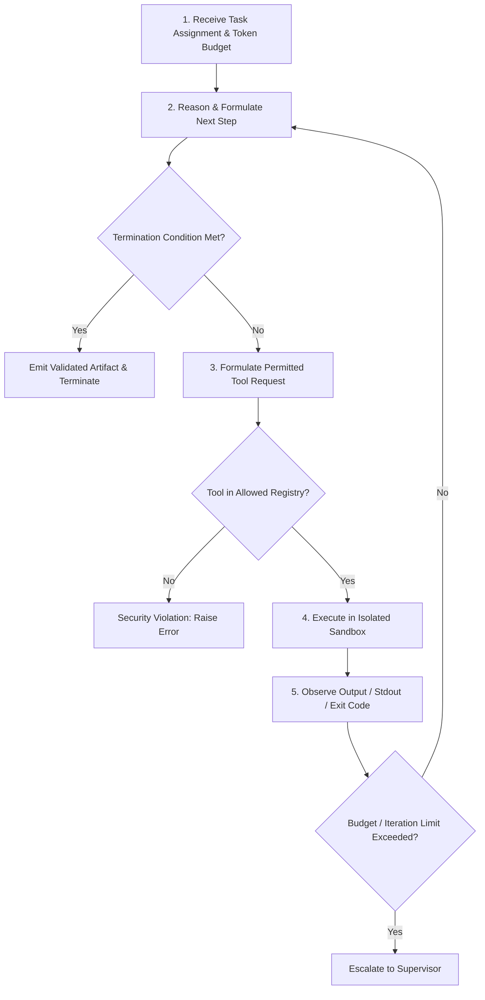

# Agent Contracts & Execution Interface: Multi-Agent Legacy Code Modernization Platform

**Document:** `docs/phase-0/agent-contracts.md`  
**Phase:** Phase 0 (Discovery, Multi-Agent Architecture & Protocol Design)  
**Date:** October 19, 2026  
**Status:** Completed  
**Author:** Principal Multi-Agent Systems Architect & Senior AI Engineer  

---

## 1. Multi-Agent System Architecture & Execution Protocols

The platform organizes modernization tasks using a two-tier model:
- **Outer Loop (Supervisor):** Directed Acyclic Graph (DAG) workflow state machine implemented with LangGraph. Authoritative over stage progression, human gates G1–G4, budget allocation, and persistent checkpointing.
- **Inner Loop (Specialist Agents):** Bounded iterative execution loops where agents reason, call permitted sandbox tools, observe outputs, and emit schema-validated deliverables.

---

## 2. Shared Inner-Loop Contract Protocol

Every specialist agent runs within a standardized inner loop governed by this execution contract:

### 2.1 Inner-Loop Termination Conditions
An agent's inner loop terminates under one of seven explicit conditions:
1. **`SUCCESS_VALIDATED`:** Agent emits a JSON payload that conforms 100% to its designated Pydantic output schema.
2. **`BUDGET_EXCEEDED`:** Cumulative token spend or USD cost breaches the task's allocated budget ceiling.
3. **`MAX_ITERATIONS_REACHED`:** Step count reaches the agent's ceiling (default: 8 iterations).
4. **`EXECUTION_TIMEOUT`:** Wall-clock duration exceeds the timeout threshold (e.g. 300 seconds).
5. **`TOOL_FAILURE`:** A critical tool (e.g. compiler or parser) fails unrecoverably.
6. **`SECURITY_VIOLATION`:** The agent attempts an unpermitted tool invocation, path traversal, or network egress.
7. **`HUMAN_ESCALATION_REQUIRED`:** The agent detects ambiguous business rules or structural deadlocks requiring manual human guidance.

---

## 3. Specialist Agent Contract Directory (11 Specialist Agents)

### 3.1 Intake Agent
- **Identifier:** `agent:intake`
- **Responsibility:** Clones repositories, extracts source archives, detects build descriptors (`pom.xml`, `build.gradle`), counts lines of code, and scans for obvious secrets.
- **Allowed Tools:** `git_clone`, `archive_extract`, `file_stat`, `secret_scan`.
- **Input Schema:** `IntakeInput` (repo_url, revision, archive_path).
- **Output Schema:** `RepoInventory` (languages, files_count, total_loc, build_tools, entry_points).
- **Default Budget:** 10,000 tokens ($0.15) | Timeout: 120s | Max Retries: 2.

### 3.2 Legacy Analyzer Agent
- **Identifier:** `agent:legacy_analyzer`
- **Responsibility:** Traverses Java ASTs using Tree-sitter / JavaParser; maps controller endpoints, service classes, entity relationships, SQL queries, and third-party dependencies.
- **Allowed Tools:** `tree_sitter_parse`, `file_read`, `dependency_tree_analyze`.
- **Input Schema:** `LegacyAnalyzerInput` (inventory_ref, source_root).
- **Output Schema:** `LegacyModel` (controllers, services, entities, sql_queries, integrations).
- **Default Budget:** 45,000 tokens ($0.65) | Timeout: 300s | Max Retries: 2.

### 3.3 Feasibility Agent
- **Identifier:** `agent:feasibility`
- **Responsibility:** Matches extracted legacy capabilities against target technology profiles (NestJS); identifies native support, library adapters, and capability gaps for Gate G1.
- **Allowed Tools:** `catalog_lookup`, `compatibility_matrix_check`.
- **Input Schema:** `FeasibilityInput` (legacy_model_ref, target_stack).
- **Output Schema:** `FeasibilityReport` (native_capabilities, library_capabilities, gaps, suggested_adapters).
- **Default Budget:** 25,000 tokens ($0.35) | Timeout: 180s | Max Retries: 1.

### 3.4 Characterizer Agent
- **Identifier:** `agent:characterizer`
- **Responsibility:** Captures legacy behavioral contracts as executable test cases and golden input/output fixtures across unit, API, data, and batch layers.
- **Allowed Tools:** `sandbox_test_run`, `mock_generator`, `fixture_record`.
- **Input Schema:** `CharacterizerInput` (legacy_model_ref, coverage_target).
- **Output Schema:** `CharacterizationSuite` (tests_count, layers, normalization_rules, content_hash).
- **Default Budget:** 60,000 tokens ($0.90) | Timeout: 450s | Max Retries: 3.

### 3.5 Architect Agent
- **Identifier:** `agent:architect`
- **Responsibility:** Synthesizes modernized target architecture, NestJS module boundaries, dependency injection schemes, and database repository abstractions.
- **Allowed Tools:** `architecture_template_render`, `schema_validator`.
- **Input Schema:** `ArchitectInput` (legacy_model_ref, feasibility_report_ref, target_stack).
- **Output Schema:** `TargetBlueprint` (module_hierarchy, entity_definitions, service_contracts).
- **Default Budget:** 35,000 tokens ($0.50) | Timeout: 240s | Max Retries: 2.

### 3.6 Planner Agent
- **Identifier:** `agent:planner`
- **Responsibility:** Organizes identified modules into a topological dependency DAG; calculates execution waves, cost estimates, and risk ratings for Gate G3.
- **Allowed Tools:** `dag_scheduler`, `effort_estimator`.
- **Input Schema:** `PlannerInput` (blueprint_ref, budget_limit).
- **Output Schema:** `ConversionPlan` (waves, module_dependencies, estimated_cost, risk_ratings).
- **Default Budget:** 20,000 tokens ($0.30) | Timeout: 180s | Max Retries: 1.

### 3.7 Schema & Data Agent
- **Identifier:** `agent:schema_data`
- **Responsibility:** Designs modern relational database schemas, TypeORM/Prisma entity classes, and deterministic data migration scripts.
- **Allowed Tools:** `sql_ddl_generate`, `migration_diff_check`.
- **Input Schema:** `SchemaDataInput` (legacy_entities, target_dialect).
- **Output Schema:** `DataMigrationPlan` (target_ddl, migration_scripts, type_mappings).
- **Default Budget:** 25,000 tokens ($0.35) | Timeout: 180s | Max Retries: 2.

### 3.8 CodeWriter Agent
- **Identifier:** `agent:codewriter`
- **Responsibility:** Converts an isolated legacy module into modern TypeScript / NestJS code on a dedicated Git branch inside an execution sandbox.
- **Allowed Tools:** `file_write`, `file_read`, `typescript_compile`, `linter_run`.
- **Input Schema:** `CodeWriterInput` (module_id, blueprint_ref, legacy_source_files).
- **Output Schema:** `ModuleArtifact` (git_branch, files_created, compilation_status).
- **Default Budget:** 50,000 tokens ($0.75) per attempt | Timeout: 300s | Max Retries: 3.

### 3.9 Verifier Agent
- **Identifier:** `agent:verifier`
- **Responsibility:** Replays frozen characterization tests against the converted module; compares JSON outputs using normalization rules; classifies differences.
- **Allowed Tools:** `sandbox_test_runner`, `diff_classifier`.
- **Input Schema:** `VerifierInput` (module_branch, frozen_suite_ref, normalization_rules).
- **Output Schema:** `EquivalenceReport` (passed_tests, regressions, intended_differences, equivalence_pct).
- **Default Budget:** 30,000 tokens ($0.45) | Timeout: 300s | Max Retries: 2.

### 3.10 Reviewer Agent
- **Identifier:** `agent:reviewer`
- **Responsibility:** Inspects generated source code for security flaws (SAST), code smell, architectural drift, and compliance with enterprise coding conventions.
- **Allowed Tools:** `semgrep_scan`, `eslint_run`, `sonarqube_check`.
- **Input Schema:** `ReviewerInput` (module_branch, security_rules).
- **Output Schema:** `QualityReview` (vulnerabilities, lint_errors, compliance_score).
- **Default Budget:** 25,000 tokens ($0.35) | Timeout: 180s | Max Retries: 1.

### 3.11 Integrator Agent
- **Identifier:** `agent:integrator`
- **Responsibility:** Merges approved module branches into the integration branch, verifies end-to-end service assembly, and drafts delivery Pull Requests for Gate G4.
- **Allowed Tools:** `git_merge`, `e2e_test_run`, `pull_request_create`.
- **Input Schema:** `IntegratorInput` (job_id, module_branches).
- **Output Schema:** `DeliveryPackage` (integration_branch, pr_url, delivery_manifest).
- **Default Budget:** 20,000 tokens ($0.30) | Timeout: 240s | Max Retries: 2.
