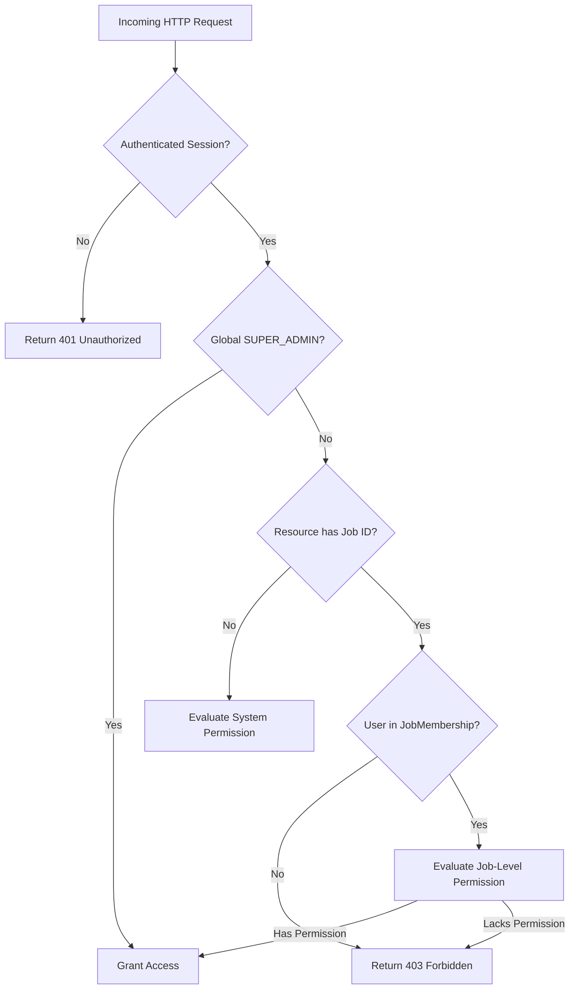

# Authentication & Authorization Architecture: Multi-Agent Legacy Code Modernization Platform

**Document:** `docs/phase-0/authentication-authorization.md`  
**Phase:** Phase 0 (Discovery, Security & Identity Architecture)  
**Date:** October 19, 2026  
**Status:** Completed  
**Author:** Principal Software Architect & Security Lead  

---

## 1. Architecture Decision Record (ADR): Session-Based Authentication for Browser Clients

### 1.1 Context & Problem Statement
The platform requires an authentication and identity mechanism that securely serves the browser-based single-page application (React 19 / TanStack Start) and supports future programmatic API client access without introducing XSS token exfiltration vulnerabilities or unnecessary distributed token revocation complexity.

### 1.2 Evaluation of Options
1. **Option A: Pure Bearer JWT in LocalStorage / SessionStorage:**
   - *Pros:* Stateless on the backend; easy cross-origin sharing.
   - *Cons:* Extremely vulnerable to token theft via Cross-Site Scripting (XSS); impossible to instantly invalidate revoked user sessions without an external distributed token blacklist.
2. **Option B: Secure Server-Side Sessions with `HttpOnly` Cookies (Selected for Browser V1):**
   - *Pros:* Immune to JavaScript access (XSS token theft); trivial instant session revocation upon logout or password change; simple CSRF protection with Double-Submit Cookie / custom headers; standard across enterprise web consoles.
   - *Cons:* Requires server-side session lookup (mitigated by fast Redis or PostgreSQL cache).
3. **Option C: Enterprise OIDC / OAuth2 with PKCE (Roadmap for Phase 1 Enterprise):**
   - *Pros:* Integrates with Okta, Azure AD, Keycloak, or Google Workspace; centralizes enterprise identity.
   - *Cons:* Requires external IdP configuration; over-engineered for initial single-tenant development.

### 1.3 Decision
**We select Option B (Secure Server-Side Sessions with `HttpOnly`, `SameSite=Lax`, and `Secure` cookies) as the primary authentication mechanism for the browser web console.** 
For programmatic CI/CD pipelines in Phase 1+, the platform will issue cryptographically hashed API keys (`rebase_ak_...`).

---

## 2. Minimum Authentication API Contracts

### 2.1 Endpoints Specification

| Method | Path | Request Body | Response Body | Auth Required | Description |
| :--- | :--- | :--- | :--- | :---: | :--- |
| `POST` | `/api/v1/auth/login` | `LoginRequest` (email, password) | `UserResponse` + Set-Cookie (`session_id`) | No (Public) | Authenticates credentials, generates 256-bit cryptographically secure session, sets `HttpOnly` cookie. |
| `POST` | `/api/v1/auth/logout` | None | `SuccessResponse` (clears cookie) | Yes (Session) | Destroys server-side session and clears client cookie. |
| `GET` | `/api/v1/auth/me` | None | `UserResponse` (profile, roles, permissions) | Yes (Session) | Returns current authenticated user identity and effective permissions. |
| `POST` | `/api/v1/auth/change-password` | `ChangePasswordRequest` (old, new) | `SuccessResponse` | Yes (Session) | Updates password and invalidates all existing sessions. |

---

## 3. Role-Based Access Control (RBAC) & Tenancy Model

### 3.1 Role Hierarchy & Permissions

```text
SUPER_ADMIN (Workspace Owner / Full System Control)
     │
   ADMIN (Job Creator, Settings & User Provisioning)
     │
  REVIEWER (Gate Approver G1–G4, Waiver Signer, Audit Inspector)
     │
 DEVELOPER (Job Explorer, Artifact Inspector, Prompt Suggestion)
     │
   VIEWER (Read-Only Inspection of Dashboards & Artifacts)
```

| Permission Token | SUPER_ADMIN | ADMIN | REVIEWER | DEVELOPER | VIEWER |
| :--- | :---: | :---: | :---: | :---: | :---: |
| `job:create` | Yes | Yes | No | No | No |
| `job:read` | Yes | Yes | Yes | Yes | Yes |
| `job:pause_resume` | Yes | Yes | Yes | No | No |
| `job:cancel` | Yes | Yes | No | No | No |
| `gate:approve_g1` | Yes | Yes | Yes | No | No |
| `gate:approve_g2` | Yes | Yes | Yes | No | No |
| `gate:approve_g3` | Yes | Yes | Yes | No | No |
| `gate:approve_g4` | Yes | Yes | Yes | No | No |
| `artifact:read` | Yes | Yes | Yes | Yes | Yes |
| `artifact:download` | Yes | Yes | Yes | Yes | No |
| `audit:read` | Yes | Yes | Yes | Yes | No |
| `settings:update` | Yes | Yes | No | No | No |
| `user:manage` | Yes | No | No | No | No |

### 3.2 Authorization Evaluation Pipeline



---

## 4. Comprehensive Security Policies

1. **Password Hashing:** Passwords must be hashed using **Argon2id** (memory cost: 64 MB, iterations: 3, parallelism: 4) or **bcrypt** with a minimum work factor of 12. Plaintext passwords are never logged or stored.
2. **Session Cookie Security Flags:**
   - `HttpOnly = true` (Prevents DOM access via `document.cookie`).
   - `Secure = true` (Requires TLS in non-development environments).
   - `SameSite = Lax` (Prevents standard cross-site request forgery).
   - Custom header requirement (`X-Requested-With: XMLHttpRequest` or `Content-Type: application/json`) to block cross-origin HTML form POST attacks.
3. **Session Lifetime & Invalidation:**
   - Idle timeout: 4 hours.
   - Absolute maximum session duration: 24 hours.
   - All active sessions are immediately invalidated when a user changes their password or an administrator revokes access.
4. **Login Rate Limiting & Brute-Force Defense:**
   - Maximum 5 failed attempts per IP / email pair within a 15-minute window.
   - Generic error messages: `"Invalid email or password"` to prevent user enumeration attacks.
5. **Initial Admin Bootstrap:**
   - The platform initializes the first `SUPER_ADMIN` via an explicit CLI bootstrap command (`python -m app.cli create-admin`) or securely seeded environment variables (`INITIAL_ADMIN_EMAIL` and `INITIAL_ADMIN_PASSWORD`). Credentials are never hardcoded in source code.
