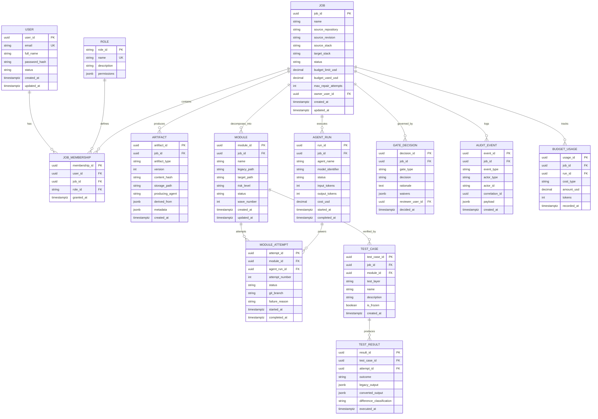

# Domain Model & Database Design: Multi-Agent Legacy Code Modernization Platform

**Document:** `docs/phase-0/domain-model.md`  
**Phase:** Phase 0 (Discovery, Domain Modeling & Data Architecture)  
**Date:** October 19, 2026  
**Status:** Completed  
**Author:** Principal Software Architect & Senior Backend Engineer  

---

## 1. Domain Model Overview & Integrity Invariants

The data model of the **Multi-Agent Legacy Code Modernization Platform** enforces strict data integrity, job-scoped tenant isolation, and regulatory-grade traceability.

### Key Data Invariants
1. **Job-Scoped Isolation:** All operational entities (`Artifact`, `Module`, `AgentRun`, `TestCase`, `GateDecision`, `AuditEvent`, `BudgetUsage`) belong to exactly one `Job`. Foreign key constraints and query filters prevent cross-job data exposure.
2. **Immutable Audit Trail:** Rows in the `audit_event` and `gate_decision` tables are append-only. Updates and deletes are prohibited by database-level triggers and application logic.
3. **Artifact Provenance & Lineage:** Every artifact records an SHA-256 content hash, an integer version number, the producing agent ID, and an array of predecessor artifact hashes (`derived_from`).
4. **Deterministic Gate Provenance:** Gate decisions record the exact user ID, role, rationale, timestamp, and target artifact content hashes.

---

## 2. Mermaid Entity-Relationship (ER) Diagram

---

## 3. Entity Specifications (13 Core Entities)

### 3.1 User
- **Purpose:** Represents human users and authorized administrators of the modernization workspace.
- **Identifier:** `user_id` (UUIDv7, Primary Key).
- **Required Fields:** `user_id`, `email`, `full_name`, `password_hash`, `status`, `created_at`, `updated_at`.
- **Optional Fields:** `avatar_url`, `last_login_at`.
- **Foreign Keys:** None.
- **Constraints / Indexes:** Unique index on `email`. Check constraint `status IN ('ACTIVE', 'INACTIVE', 'SUSPENDED')`.
- **Retention Rules:** Retained indefinitely; soft-deleted by setting status to `INACTIVE`.

### 3.2 Role
- **Purpose:** Predefined global and job-level permissions for Role-Based Access Control.
- **Identifier:** `role_id` (String, e.g. `'SUPER_ADMIN'`, `'ADMIN'`, `'REVIEWER'`, `'DEVELOPER'`, `'VIEWER'`).
- **Required Fields:** `role_id`, `name`, `description`, `permissions` (JSON array of permission strings).
- **Constraints / Indexes:** Primary Key on `role_id`.

### 3.3 JobMembership
- **Purpose:** Maps users to specific jobs with assigned roles, enforcing job-level tenancy boundaries.
- **Identifier:** `membership_id` (UUIDv7).
- **Required Fields:** `membership_id`, `user_id`, `job_id`, `role_id`, `granted_at`.
- **Foreign Keys:** `user_id REFERENCES user(user_id)`, `job_id REFERENCES job(job_id) ON DELETE CASCADE`, `role_id REFERENCES role(role_id)`.
- **Constraints / Indexes:** Unique compound index `(user_id, job_id)`.

### 3.4 Job
- **Purpose:** The root aggregate representing a complete legacy modernization project from intake to verified delivery.
- **Identifier:** `job_id` (UUIDv7).
- **Required Fields:** `job_id`, `name`, `source_repository`, `source_revision`, `source_stack`, `target_stack`, `status`, `budget_limit_usd`, `budget_used_usd`, `max_repair_attempts`, `owner_user_id`, `created_at`, `updated_at`.
- **Optional Fields:** `description`, `target_repository`, `integration_branch`.
- **Foreign Keys:** `owner_user_id REFERENCES user(user_id)`.
- **Constraints / Indexes:** Check constraint on status. Index on `status`, `created_at`. Check `budget_used_usd <= budget_limit_usd`.

### 3.5 Artifact
- **Purpose:** Versioned, immutable deliverable produced during modernization (e.g. `RepoInventory`, `FeasibilityReport`, `CharacterizationSuite`, `TargetBlueprint`, `ConversionPlan`, `EquivalenceReport`).
- **Identifier:** `artifact_id` (UUIDv7).
- **Required Fields:** `artifact_id`, `job_id`, `artifact_type`, `version`, `content_hash` (SHA-256), `storage_path`, `producing_agent`, `created_at`.
- **Optional Fields:** `derived_from` (JSON array of predecessor hashes), `metadata` (JSONB).
- **Foreign Keys:** `job_id REFERENCES job(job_id) ON DELETE CASCADE`.
- **Constraints / Indexes:** Unique compound index on `(job_id, artifact_type, version)`. Index on `content_hash`.

### 3.6 Module
- **Purpose:** Logical subdivision of the legacy codebase isolated for conversion and verification.
- **Identifier:** `module_id` (UUIDv7).
- **Required Fields:** `module_id`, `job_id`, `name`, `legacy_path`, `target_path`, `risk_level`, `status`, `wave_number`, `created_at`, `updated_at`.
- **Foreign Keys:** `job_id REFERENCES job(job_id) ON DELETE CASCADE`.
- **Constraints / Indexes:** `risk_level IN ('LOW', 'MEDIUM', 'HIGH')`. Index on `(job_id, status)`.

### 3.7 ModuleAttempt
- **Purpose:** Tracks an individual conversion iteration of a module by a CodeWriter agent, enforcing bounded retry rules.
- **Identifier:** `attempt_id` (UUIDv7).
- **Required Fields:** `attempt_id`, `module_id`, `agent_run_id`, `attempt_number`, `status`, `git_branch`, `started_at`.
- **Optional Fields:** `failure_reason`, `completed_at`.
- **Foreign Keys:** `module_id REFERENCES module(module_id) ON DELETE CASCADE`, `agent_run_id REFERENCES agent_run(run_id)`.
- **Constraints / Indexes:** Unique compound index on `(module_id, attempt_number)`. Check `attempt_number <= 5`.

### 3.8 AgentRun
- **Purpose:** Execution trace for a specialist agent invocation, tracking token spend, duration, and output schemas.
- **Identifier:** `run_id` (UUIDv7).
- **Required Fields:** `run_id`, `job_id`, `agent_name`, `model_identifier`, `status`, `input_tokens`, `output_tokens`, `cost_usd`, `started_at`.
- **Optional Fields:** `completed_at`, `error_message`.
- **Foreign Keys:** `job_id REFERENCES job(job_id) ON DELETE CASCADE`.
- **Constraints / Indexes:** Index on `(job_id, agent_name, started_at)`.

### 3.9 TestCase
- **Purpose:** Executable behavioral test captured by the Characterizer agent.
- **Identifier:** `test_case_id` (UUIDv7).
- **Required Fields:** `test_case_id`, `job_id`, `test_layer`, `name`, `is_frozen`, `created_at`.
- **Optional Fields:** `module_id`, `description`, `fixture_payload`.
- **Foreign Keys:** `job_id REFERENCES job(job_id) ON DELETE CASCADE`, `module_id REFERENCES module(module_id)`.
- **Constraints / Indexes:** `test_layer IN ('UNIT', 'API_CONTRACT', 'DATA_EFFECT', 'BATCH', 'UI_FLOW')`.

### 3.10 TestResult
- **Purpose:** Records the comparison outcome of executing a TestCase against converted code.
- **Identifier:** `result_id` (UUIDv7).
- **Required Fields:** `result_id`, `test_case_id`, `attempt_id`, `outcome`, `difference_classification`, `executed_at`.
- **Optional Fields:** `legacy_output` (JSONB), `converted_output` (JSONB).
- **Foreign Keys:** `test_case_id REFERENCES test_case(test_case_id) ON DELETE CASCADE`, `attempt_id REFERENCES module_attempt(attempt_id)`.
- **Constraints / Indexes:** `outcome IN ('PASSED', 'FAILED')`. `difference_classification IN ('NONE', 'REGRESSION', 'INTENDED_DIFFERENCE', 'NONDETERMINISTIC', 'TEST_DEFECT')`.

### 3.11 GateDecision
- **Purpose:** Immutable record of a human review decision at approval gates G1 through G4.
- **Identifier:** `decision_id` (UUIDv7).
- **Required Fields:** `decision_id`, `job_id`, `gate_type`, `decision`, `rationale`, `reviewer_user_id`, `decided_at`.
- **Optional Fields:** `waivers` (JSONB array of signed waivers).
- **Foreign Keys:** `job_id REFERENCES job(job_id) ON DELETE CASCADE`, `reviewer_user_id REFERENCES user(user_id)`.
- **Constraints / Indexes:** `gate_type IN ('G1', 'G2', 'G3', 'G4')`. `decision IN ('APPROVED', 'REJECTED')`. Rationale length >= 10 characters.

### 3.12 AuditEvent
- **Purpose:** Append-only regulatory audit log capturing all significant user decisions and agent operations.
- **Identifier:** `event_id` (UUIDv7).
- **Required Fields:** `event_id`, `job_id`, `event_type`, `actor_type`, `actor_id`, `created_at`.
- **Optional Fields:** `correlation_id` (UUIDv7), `payload` (JSONB).
- **Foreign Keys:** `job_id REFERENCES job(job_id) ON DELETE CASCADE`.
- **Constraints / Indexes:** Immutable. Index on `(job_id, created_at)`, index on `correlation_id`.

### 3.13 BudgetUsage
- **Purpose:** Tracks granular token and infrastructure costs against the job budget ceiling.
- **Identifier:** `usage_id` (UUIDv7).
- **Required Fields:** `usage_id`, `job_id`, `cost_type`, `amount_usd`, `tokens`, `recorded_at`.
- **Optional Fields:** `run_id REFERENCES agent_run(run_id)`.
- **Foreign Keys:** `job_id REFERENCES job(job_id) ON DELETE CASCADE`.
- **Constraints / Indexes:** Index on `(job_id, recorded_at)`.
