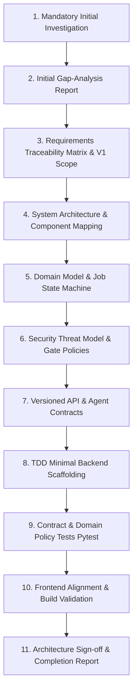
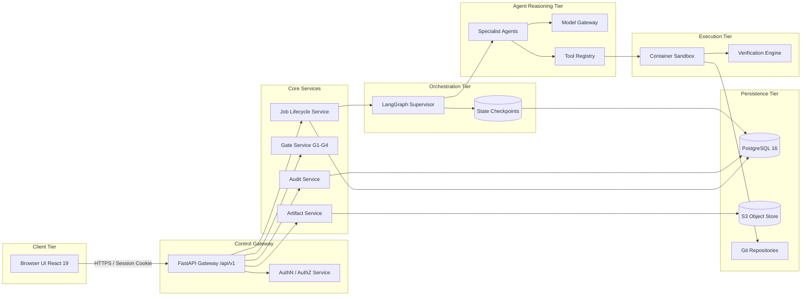
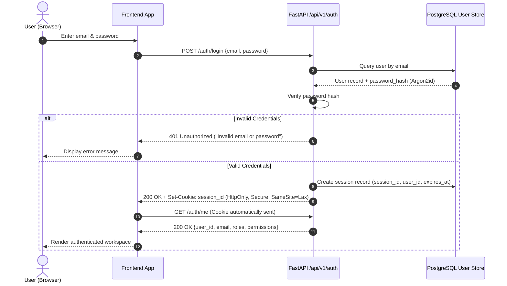
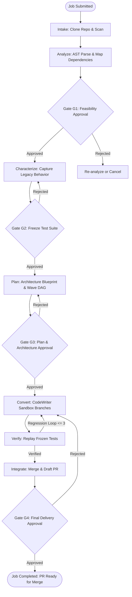
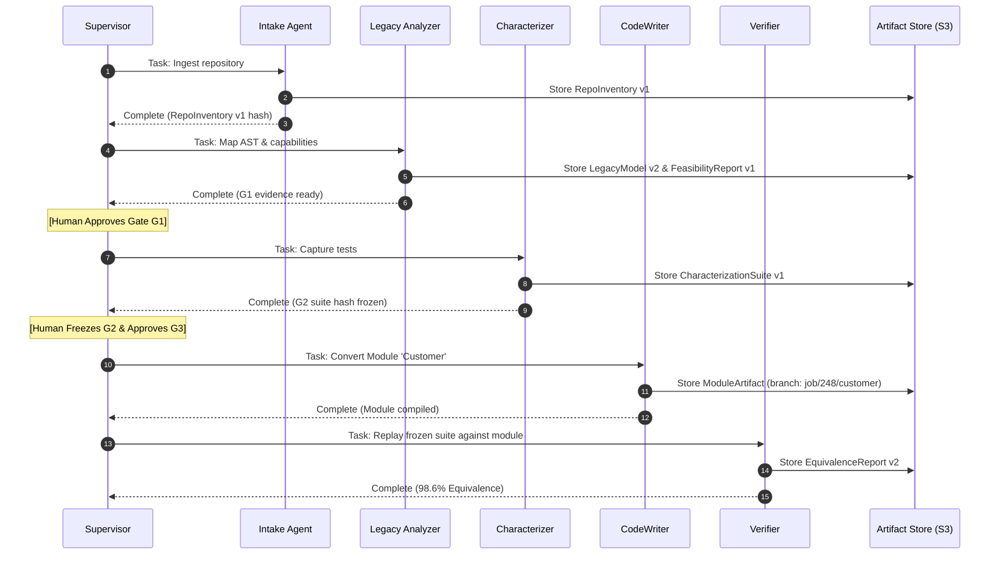
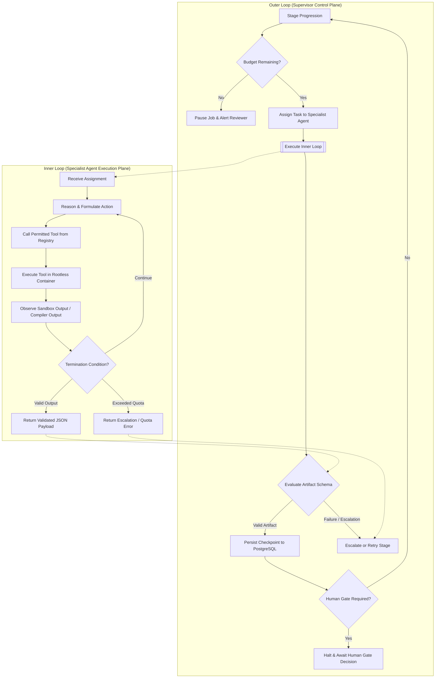
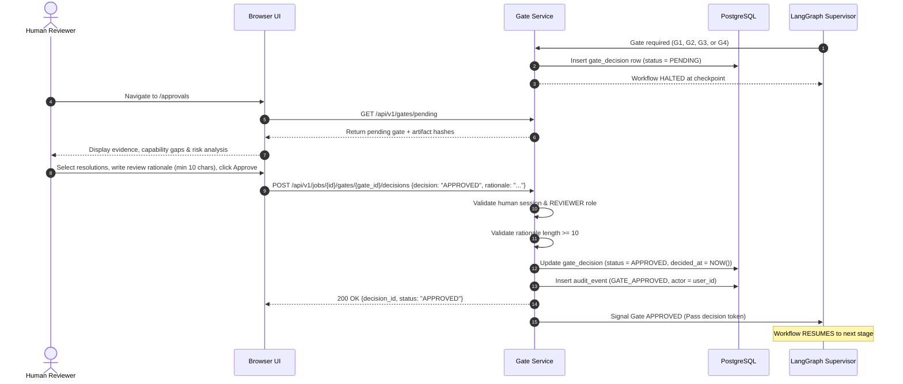

# Phase 0 Architectural Flowcharts: Multi-Agent Legacy Code Modernization Platform

**Document:** `docs/phase-0/flowcharts.md`  
**Phase:** Phase 0 (Discovery, Architecture & Visual Specifications)  
**Date:** October 19, 2026  
**Status:** Completed  
**Author:** Principal Software Architect & Multi-Agent Systems Architect  

---

## Flowchart A: Phase 0 Implementation Workflow

---

## Flowchart B: Complete Platform Architecture

---

## Flowchart C: Authentication & Session Lifecycle Flow

---

## Flowchart D: Modernization Job Lifecycle

---

## Flowchart E: Multi-Agent Collaboration Workflow

---

## Flowchart F: Inner Loop vs. Outer Loop Architecture

---

## Flowchart G: Human Approval Gate Workflow (G1–G4)

