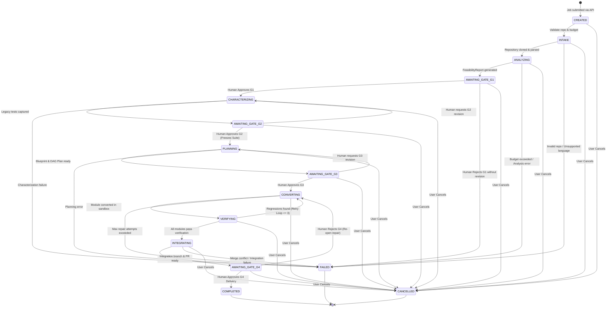

# Job State Machine: Multi-Agent Legacy Code Modernization Platform

**Document:** `docs/phase-0/job-state-machine.md`  
**Phase:** Phase 0 (Discovery, Lifecycle & State Machine Architecture)  
**Date:** October 19, 2026  
**Status:** Completed  
**Author:** Principal Software Architect & Senior Backend Engineer  

---

## 1. Lifecycle Overview & State Invariants

The **Job State Machine** governs the execution lifecycle of a legacy code modernization project from initial submission to final verified delivery.

### Key Invariants
1. **Deterministic Sequential Transitions:** Stage progression follows an outer-loop DAG. Work cannot proceed to downstream stages without passing upstream preconditions.
2. **Non-Bypassable Gate Blocking:** When entering an `AWAITING_GATE_*` state, execution is halted, checkpoints are committed to PostgreSQL, and automated workers are paused until an authorized human decision is submitted.
3. **Idempotent Transitions:** Duplicate transition requests emit identical state results without triggering duplicate agent runs or state corruption.
4. **Controlled Cancellation:** Cancellation is permitted from any non-terminal state. It immediately revokes active sandbox processes and releases allocated budget reservations.

---

## 2. Mermaid State Transition Diagram

---

## 3. Detailed State Transition Matrix

| State Name | Allowed Prior States | Allowed Next States | Trigger Event | Responsible Actor / Service | Preconditions | Side Effects & Audit Events |
| :--- | :--- | :--- | :--- | :--- | :--- | :--- |
| **`CREATED`** | None (Initial) | `INTAKE`, `CANCELLED` | `POST /jobs` | API Gateway / User | Valid JSON request, authorized user. | Record `JOB_CREATED` audit event. Allocate initial budget reservation. |
| **`INTAKE`** | `CREATED` | `ANALYZING`, `FAILED`, `CANCELLED` | Worker worker pickup | Intake Agent / Worker | Storage available, repo accessible. | Clone repo into sandbox. Check Java build file existence (`pom.xml`). |
| **`ANALYZING`** | `INTAKE` | `AWAITING_GATE_G1`, `FAILED`, `CANCELLED` | AST generation | Legacy Analyzer Agent | AST parser completes without fatal crash. | Generate `RepoInventory v1` and `FeasibilityReport v1`. Track token spend. |
| **`AWAITING_GATE_G1`** | `ANALYZING` | `CHARACTERIZING`, `FAILED`, `CANCELLED` | `FeasibilityReport` ready | Supervisor | G1 evidence persisted and hashed. | Workflow paused. Record `GATE_G1_REQUESTED`. |
| **`CHARACTERIZING`** | `AWAITING_GATE_G1`, `AWAITING_GATE_G2` | `AWAITING_GATE_G2`, `FAILED`, `CANCELLED` | `G1` approved | Characterizer Agent | G1 decision = `APPROVED`. | Execute legacy test harness. Capture outputs & golden JSON fixtures. |
| **`AWAITING_GATE_G2`** | `CHARACTERIZING` | `PLANNING`, `CHARACTERIZING`, `CANCELLED` | Suite captured | Supervisor | `CharacterizationSuite v1` persisted. | Workflow paused. Record `GATE_G2_REQUESTED`. |
| **`PLANNING`** | `AWAITING_GATE_G2`, `AWAITING_GATE_G3` | `AWAITING_GATE_G3`, `FAILED`, `CANCELLED` | `G2` approved | Architect & Planner Agents | G2 decision = `APPROVED` (frozen suite hash locked). | Generate `TargetBlueprint v2` and `ConversionPlan v3` with module dependency DAG. |
| **`AWAITING_GATE_G3`** | `PLANNING` | `CONVERTING`, `PLANNING`, `CANCELLED` | Plan ready | Supervisor | Architecture blueprint persisted. | Workflow paused. Record `GATE_G3_REQUESTED`. |
| **`CONVERTING`** | `AWAITING_GATE_G3`, `VERIFYING`, `AWAITING_GATE_G4` | `VERIFYING`, `FAILED`, `CANCELLED` | `G3` approved / Repair cycle | CodeWriter Agent | G3 decision = `APPROVED`. Wave dependencies satisfied. | Generate TypeScript/NestJS files in isolated Git branch `job/{id}/module-{name}`. |
| **`VERIFYING`** | `CONVERTING` | `CONVERTING`, `INTEGRATING`, `FAILED`, `CANCELLED` | Code compiled | Verifier Agent | Module generated; compiler passes. | Replay frozen test suite against converted code. Classify behavioral differences. |
| **`INTEGRATING`** | `VERIFYING` | `AWAITING_GATE_G4`, `FAILED`, `CANCELLED` | All modules verified | Integrator Agent | 100% of modules verified. | Merge module branches into `job/{id}/integration`. Open draft Pull Request. |
| **`AWAITING_GATE_G4`** | `INTEGRATING` | `COMPLETED`, `CONVERTING`, `CANCELLED` | PR created | Supervisor | `EquivalenceReport` & `JobReport` ready. | Workflow paused. Record `GATE_G4_REQUESTED`. |
| **`COMPLETED`** | `AWAITING_GATE_G4` | None (Terminal) | `G4` approved | Supervisor / Reviewer | G4 decision = `APPROVED` with all waivers signed. | Mark PR ready for merge. Release reservations. Record `JOB_COMPLETED`. |
| **`FAILED`** | Any non-terminal state | None (Terminal) | Fatal error / Unrecoverable exception | System / Supervisor | Error condition detected. | Record `JOB_FAILED` with error classification and reason. Clean up sandboxes. |
| **`CANCELLED`** | Any non-terminal state | None (Terminal) | `POST /jobs/{id}/cancel` | User / Admin | Authorized cancel request. | Kill active containers. Record `JOB_CANCELLED`. Release budget. |

---

## 4. Edge Cases, Race Conditions & Terminal Invariants

1. **Illegal State Transitions:**
   Any request attempting an invalid transition (e.g. from `CREATED` directly to `CONVERTING` or bypassing an approval gate) is rejected with an HTTP 409 Conflict error and logged as a security violation.
2. **Idempotent Decision Submissions:**
   If a user submits an identical approval decision twice (e.g. double-click), the second request returns the existing decision record without altering job state or dispatching redundant worker events.
3. **Budget Depletion During Conversion:**
   If a CodeWriter agent's token consumption exceeds `job.budget_limit_usd`, the job transitions immediately to `PAUSED` (or `FAILED` if unresolvable) and flags the event in the audit trail.
4. **Terminal State Immutability:**
   Once a job reaches `COMPLETED`, `FAILED`, or `CANCELLED`, its state cannot be updated. Any further state transition triggers throw an `IllegalStateTransitionException`.
