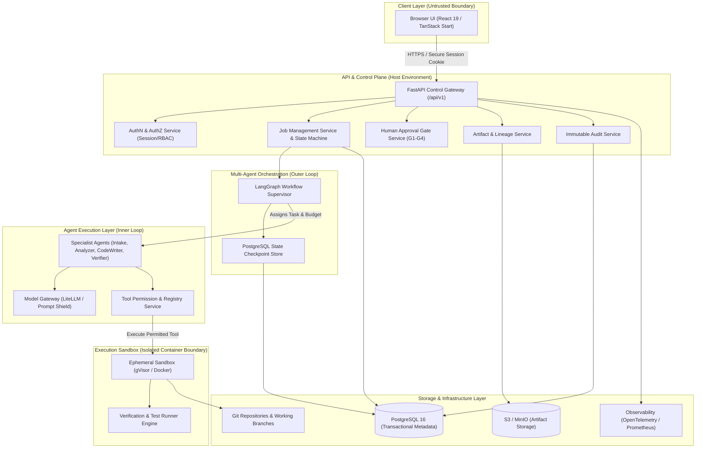
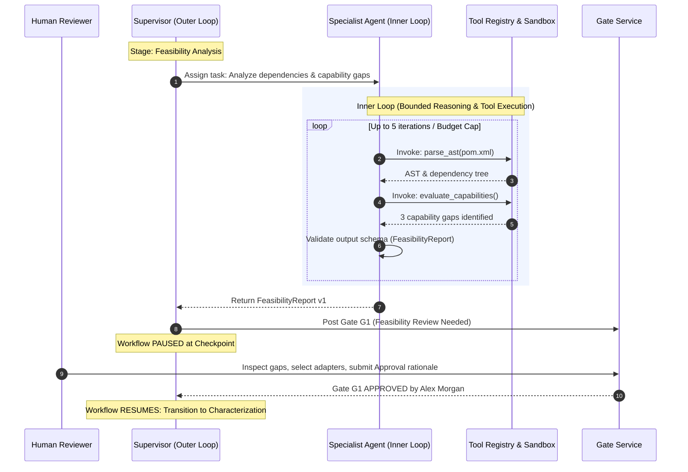

# System Architecture: Multi-Agent Legacy Code Modernization Platform

**Document:** `docs/phase-0/system-architecture.md`  
**Phase:** Phase 0 (Discovery, Architecture & System Design)  
**Date:** October 19, 2026  
**Status:** Completed  
**Author:** Principal Software Architect & Multi-Agent Systems Architect  

---

## 1. Architectural Overview & Design Principles

The **Multi-Agent Legacy Code Modernization Platform** ("Rebase") is a secure, human-in-the-loop distributed platform designed to convert complex legacy monolithic applications into verified modern architectures.

### Core Architectural Principles
1. **Contract-First & Typed Boundaries:** Every service, agent handoff, and UI interaction is governed by strictly versioned Pydantic and OpenAPI schemas.
2. **Outer-Loop / Inner-Loop Separation:** Workflow orchestration, state transitions, and approval gates operate in an outer loop controlled by a LangGraph supervisor. Agent reasoning, tool invocation, and code generation occur in bounded inner loops inside isolated execution sandboxes.
3. **Non-Bypassable Human Approval Gates (G1–G4):** Autonomous agents cannot approve gates, bypass failing tests, or self-authorize delivery branches.
4. **Behavioral Equivalence Through Frozen Characterization:** Legacy behavior is frozen into executable characterization suites prior to conversion. Modernized code must satisfy this immutable baseline.
5. **Secure-by-Default Isolation:** Untrusted legacy source code and agent-generated artifacts run in ephemeral, restricted container sandboxes with network egress controls.

---

## 2. High-Level System Architecture Diagram

---

## 3. Component Directory (18 Core Components)

### 3.1 Browser UI
- **Responsibility:** Present modern, responsive UI for job monitoring, code inspection, G1–G4 gate reviews, agent traces, and settings.
- **Inputs:** User clicks, form inputs, session cookies.
- **Outputs:** HTTP requests to `/api/v1/*`.
- **Dependencies:** Web browser runtime, FastAPI endpoints.
- **Trust Boundary:** Untrusted public client.
- **Failure Behavior:** Graceful error toasts, retry buttons, and disconnected preview mode disclosures.
- **Implementation Phase:** Phase 0 (Scaffold & Mock Screens), Phase 1 (Live API Wiring).

### 3.2 FastAPI Application Gateway
- **Responsibility:** Route incoming HTTP requests, enforce TLS, CORS, CSRF tokens, request validation, and uniform error envelopes.
- **Inputs:** HTTP requests from UI.
- **Outputs:** JSON responses conforming to OpenAPI schema.
- **Dependencies:** Python 3.13+, Uvicorn, Pydantic.
- **Trust Boundary:** Perimeter gateway; authenticates all traffic before internal routing.
- **Failure Behavior:** 4xx validation errors, 500 error envelopes without internal stack traces.
- **Implementation Phase:** Phase 0.

### 3.3 Authentication Service
- **Responsibility:** Verify user credentials, issue secure `HttpOnly` session cookies, manage session invalidation, and rate-limit login attempts.
- **Inputs:** Login credentials (email, password) or OAuth authorization codes.
- **Outputs:** Authenticated user session record.
- **Dependencies:** Database user store, password hasher (Argon2id/bcrypt).
- **Trust Boundary:** Highly trusted internal security component.
- **Failure Behavior:** 401 Unauthorized, progressive delays on brute-force attempts.
- **Implementation Phase:** Phase 0 (Contract), Phase 1 (Persistent Sessions).

### 3.4 Authorization Service
- **Responsibility:** Evaluate user identity, global roles (ADMIN, REVIEWER, DEVELOPER, VIEWER), and job-level membership before granting access.
- **Inputs:** User ID, requested resource, action.
- **Outputs:** Allow / Deny decision.
- **Dependencies:** PostgreSQL membership records.
- **Trust Boundary:** Internal policy enforcement point.
- **Failure Behavior:** 403 Forbidden with structured error code.
- **Implementation Phase:** Phase 0 (Domain Model & Policies), Phase 1 (Full RBAC).

### 3.5 Job Management Service
- **Responsibility:** Maintain job entity lifecycle, enforce state transition rules, and coordinate outer-loop execution.
- **Inputs:** Job creation requests, lifecycle commands (pause, resume, cancel).
- **Outputs:** Job status updates, lifecycle events.
- **Dependencies:** PostgreSQL, Supervisor layer.
- **Trust Boundary:** Control plane.
- **Failure Behavior:** Rejects invalid transitions; rolls back uncommitted stages.
- **Implementation Phase:** Phase 0 (State Machine Scaffolding), Phase 1 (Persistence).

### 3.6 Artifact Service
- **Responsibility:** Store, version, hash (SHA-256), and retrieve immutable analysis and modernization deliverables.
- **Inputs:** Agent output deliverables, metadata, source lineage references.
- **Outputs:** Versioned artifact records, presigned download URLs.
- **Dependencies:** S3-compatible storage, PostgreSQL.
- **Trust Boundary:** Control plane; enforces read access by job membership.
- **Failure Behavior:** Read-only fallback if object storage is degraded.
- **Implementation Phase:** Phase 0 (Schemas & Contracts), Phase 1 (Storage Engine).

### 3.7 Git Adapter
- **Responsibility:** Clone source repositories into sandboxes, manage isolated feature branches per module, create pull requests.
- **Inputs:** Git repository URL, commit revision, branch names, patch contents.
- **Outputs:** Local repository workspaces, branch commits, pull requests.
- **Dependencies:** Git CLI, libgit2, SSH deploy keys.
- **Trust Boundary:** Executes within isolated worker environments.
- **Failure Behavior:** Retry on transient network errors; abort on authentication failure.
- **Implementation Phase:** Phase 1.

### 3.8 Supervisor Orchestration Layer (Outer Loop)
- **Responsibility:** Coordinate the modernization workflow DAG via LangGraph, manage state checkpoints, enforce budget limits, and trigger human approval gates.
- **Inputs:** Job state, agent outputs, human gate decisions.
- **Outputs:** Task assignments to specialist agents, stage progression commands.
- **Dependencies:** LangGraph, PostgreSQL checkpoint store.
- **Trust Boundary:** Core orchestrator; authoritative over agent execution lifecycle.
- **Failure Behavior:** Pauses workflow at current checkpoint; flags job for human intervention.
- **Implementation Phase:** Phase 2.

### 3.9 Agent Runtime (Inner Loop)
- **Responsibility:** Execute specialist agent prompt chains (Intake, Analyzer, CodeWriter, Verifier), enforce step limits and token quotas.
- **Inputs:** Supervisor task assignment, context artifacts, model responses.
- **Outputs:** Structured JSON output artifacts, tool requests.
- **Dependencies:** Model Gateway, Tool Registry.
- **Trust Boundary:** Semi-trusted reasoning layer; output is schema-validated before acceptance.
- **Failure Behavior:** Bounded retries (up to 3); escalates to supervisor on repeated failure.
- **Implementation Phase:** Phase 2.

### 3.10 Tool Registry
- **Responsibility:** Expose whitelisted tools (file read, AST parse, test execution) mapped to agent role permissions.
- **Inputs:** Agent tool invocation requests with arguments.
- **Outputs:** Sanitized tool execution results.
- **Dependencies:** Sandbox execution service.
- **Trust Boundary:** Enforces security policy; blocks prohibited operations.
- **Failure Behavior:** Throws ToolPermissionDeniedException back to the agent inner loop.
- **Implementation Phase:** Phase 2.

### 3.11 Model Gateway
- **Responsibility:** Abstract LLM providers (Anthropic, OpenAI, Azure, Vertex), manage API keys, log token usage, and enforce prompt shielding.
- **Inputs:** System prompts, chat histories, tool definitions.
- **Outputs:** Streamed or synchronous model completions.
- **Dependencies:** LiteLLM / provider SDKs.
- **Trust Boundary:** Security filter between agents and external AI APIs.
- **Failure Behavior:** Automatic failover to backup model tier on rate-limit (429) or outage (503).
- **Implementation Phase:** Phase 2.

### 3.12 Sandbox Execution Service
- **Responsibility:** Spin up ephemeral containers (Docker / gVisor) with strict CPU, memory, timeout, and disk quotas to execute untrusted code.
- **Inputs:** Repository code, conversion patches, test commands.
- **Outputs:** Command stdout, stderr, exit codes, generated files.
- **Dependencies:** Container runtime (Docker / Containerd).
- **Trust Boundary:** Untrusted isolated environment; zero network egress by default.
- **Failure Behavior:** Immediate container termination upon timeout or quota breach.
- **Implementation Phase:** Phase 2.

### 3.13 Verification Service
- **Responsibility:** Replay frozen characterization test suites against converted code and classify behavioral differences.
- **Inputs:** Frozen test suite, modernized codebase, normalization rules.
- **Outputs:** Behavioral equivalence reports, regression logs, coverage metrics.
- **Dependencies:** Sandbox execution engine, test runners (Vitest, JUnit, Pytest).
- **Trust Boundary:** Verified output engine; results are cryptographically attested.
- **Failure Behavior:** Flags any mismatch as a regression or intended difference requiring G4 waiver.
- **Implementation Phase:** Phase 2.

### 3.14 Gate Approval Service
- **Responsibility:** Record human decisions for gates G1–G4, validate reviewer rationale, and enforce non-bypassable workflow unblocking.
- **Inputs:** Gate decision payloads (Approved / Rejected, rationale, waivers).
- **Outputs:** Verified GateDecision event; unblocks supervisor workflow.
- **Dependencies:** PostgreSQL, AuthZ Service.
- **Trust Boundary:** Highly trusted governance service; only accepts human reviewer tokens.
- **Failure Behavior:** Reject requests lacking rationale or authorized roles.
- **Implementation Phase:** Phase 0 (Contract & Domain Rules), Phase 1 (Persistent Logic).

### 3.15 Audit Service
- **Responsibility:** Record immutable, append-only events for all agent actions, tool calls, and human decisions.
- **Inputs:** Audit event payloads from API, Supervisor, and Gate services.
- **Outputs:** Queryable audit trail with correlation IDs.
- **Dependencies:** PostgreSQL append-only tables.
- **Trust Boundary:** Compliance & integrity service; events cannot be modified or deleted.
- **Failure Behavior:** Audit write failures block state transitions to guarantee traceability.
- **Implementation Phase:** Phase 0 (Schemas), Phase 1 (Database Engine).

### 3.16 PostgreSQL 16
- **Responsibility:** Transactional storage for users, jobs, gate decisions, audit events, and LangGraph workflow checkpoints.
- **Inputs:** SQL queries and transactions.
- **Outputs:** Persisted relational records.
- **Dependencies:** Managed database or containerized PostgreSQL instance.
- **Trust Boundary:** Core internal database.
- **Failure Behavior:** Connection pool retries; read replicas for reporting.
- **Implementation Phase:** Phase 1.

### 3.17 Object Storage (S3 / MinIO)
- **Responsibility:** Store large binary artifacts, zip archives, golden test datasets, and AST dumps.
- **Inputs:** Binary streams and multipart uploads.
- **Outputs:** Stored objects, signed GET/PUT URLs.
- **Dependencies:** AWS S3 or MinIO.
- **Trust Boundary:** Secure storage behind IAM controls.
- **Failure Behavior:** Transient retry with exponential backoff.
- **Implementation Phase:** Phase 1.

### 3.18 Observability Layer
- **Responsibility:** Collect OpenTelemetry distributed traces, Prometheus metrics, and structured JSON logs.
- **Inputs:** Trace spans, metric increments, log records.
- **Outputs:** Dashboards, alerts, and operational monitoring.
- **Dependencies:** OpenTelemetry SDK, Prometheus, Grafana.
- **Trust Boundary:** Monitoring infrastructure.
- **Failure Behavior:** Non-blocking asynchronous telemetry dispatch.
- **Implementation Phase:** Phase 1.

---

## 4. Separation of Concerns: Outer Loop vs. Inner Loop

### Outer Loop Responsibilities (Control Plane)
- Overall job state transitions (`Created` → `Analyzing` → `Awaiting Gate` → etc.).
- LangGraph persistent state checkpointing to PostgreSQL.
- Job budget enforcement and global timeout monitoring.
- Halting on human gates G1, G2, G3, G4 and unblocking upon verified human approval.
- Escalation handling when an inner loop exceeds retry or token limits.

### Inner Loop Responsibilities (Execution Plane)
- Specialized agent prompt execution and chain-of-thought reasoning.
- Selecting and calling permitted tools from the registry.
- Observing sandbox command outputs and verifying compiler/test outputs.
- Repair attempts for failed module conversions (up to configured maximum, e.g. 3).
- Emitting typed, schema-validated artifacts back to the supervisor.
