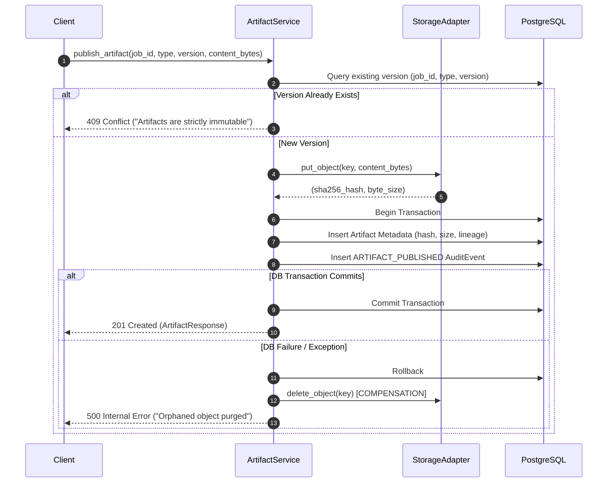

# Artifact Storage, Integrity & Lineage Architecture
## Phase 1 Deliverable Immutability & Provenance

**Document:** `docs/phase-1/artifact-storage-and-lineage.md`  
**Phase:** Phase 1 (Artifact Engine & Storage Adapter)  
**Date:** October 19, 2026  
**Status:** Completed & Verified  

---

## 1. Storage Abstraction Architecture

Artifact files are decoupled from database metadata via a **provider-independent storage abstraction**:

```text
                     ┌──────────────────────────────┐
                     │   StorageAdapter (ABC)       │
                     └──────────────┬───────────────┘
                                    │
           ┌────────────────────────┴────────────────────────┐
           ▼                                                 ▼
┌──────────────────────────────┐          ┌──────────────────────────────┐
│     LocalStorageAdapter      │          │    InMemoryStorageAdapter    │
│ (Air-gapped Dev & Testing)   │          │  (Fast Unit Test Isolation)  │
└──────────────────────────────┘          └──────────────────────────────┘
```

### Supported Storage Operations
1. `put_object(key, data, media_type) -> (sha256_hash, byte_size)`
2. `get_object(key) -> bytes`
3. `object_exists(key) -> bool`
4. `delete_object(key) -> bool`

Path traversal is strictly prohibited: `_resolve_safe_path()` checks `target_path.relative_to(base_dir)` and raises `StorageException` on escape sequences (`../`).

---

## 2. Staged-Write Compensation Pattern

Because object storage and relational databases do not participate in a single distributed 2-phase commit transaction, the platform implements a **staged-write with compensation strategy**:



---

## 3. Cryptographic Lineage & Integrity Verification

1. **SHA-256 Content Hashing:** Calculated from raw payload bytes on upload and stored in `artifacts.content_hash`.
2. **Download Integrity Verification:** When retrieving artifact content via `GET /api/v1/jobs/{job_id}/artifacts/{artifact_id}/content`, the service recomputes the SHA-256 checksum and compares it against the persisted hash. Any divergence raises `ARTIFACT_CORRUPTION_DETECTED` (500).
3. **Directed Acyclic Lineage (DAG):** Each artifact captures `derived_from` (an array of parent SHA-256 hashes). Downstream artifacts (e.g. `TargetBlueprint v2`) explicitly link to predecessor deliverables (`LegacyModel v2`, `RepoInventory v1`).
4. **Version Immutability:** Overwriting an existing version is rejected by the database unique constraint `uq_artifact_version (job_id, artifact_type, version)` and application-level validation.
