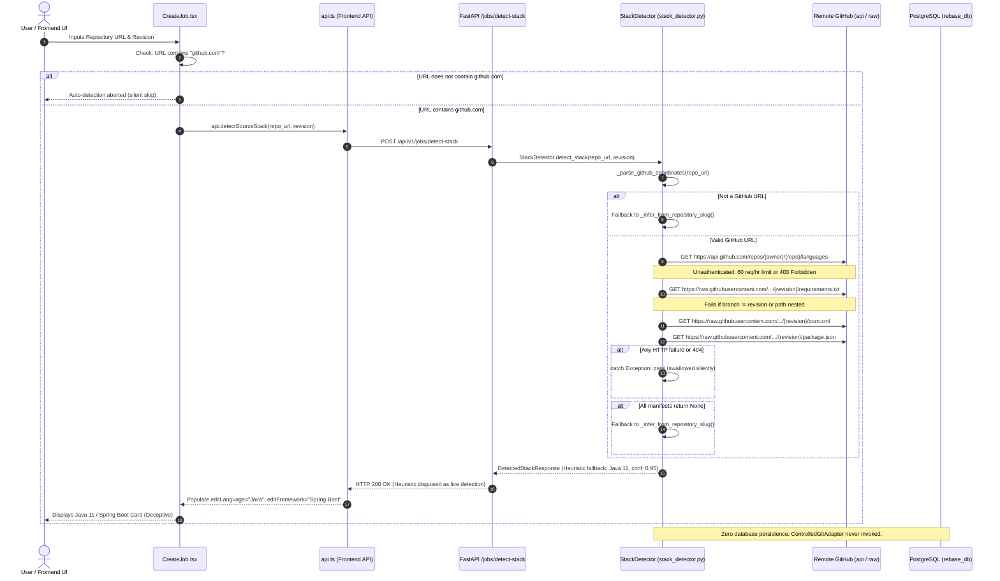
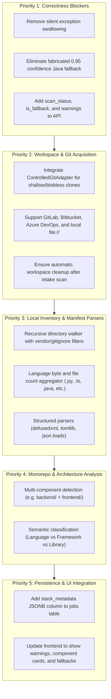

# REBASE — Technology Stack Detection API Audit
## Endpoint: `POST /api/v1/jobs/detect-stack`

**Document:** `docs/phase-2/stack-detection-audit.md`  
**Phase:** Phase 2 Intake & Characterization Assessment (Audit Only)  
**Date:** October 19, 2026  
**Status:** **AUDIT COMPLETE — MULTIPLE ROOT CAUSES IDENTIFIED**  
**Author:** Principal Software Architect, Senior Backend Systems Engineer, Application Security Engineer  

---

## A. Executive Summary

An exhaustive, evidence-based audit was conducted on the legacy technology stack detection API endpoint (`POST /api/v1/jobs/detect-stack`) within the **Rebase Multi-Agent Legacy Code Modernization Platform**.

### 1. Current Endpoint Behavior
The endpoint currently responds with **HTTP 200 OK** for virtually all requests. However, the payload returned is frequently inaccurate, misleading, or completely fabricated. When submitted against repositories that are private, non-GitHub (e.g., GitLab, Bitbucket, Azure DevOps, local Git checkouts), monorepos, repos with nested source folders, or repositories using branches other than `main`, the endpoint returns a hardcoded fallback:
```json
{
  "primary_language": "Java",
  "language_version": "Java 11 (LTS)",
  "framework": "Spring Boot",
  "framework_version": "2.7.14",
  "build_tool": "Maven (pom.xml)",
  "build_file": "pom.xml",
  "test_framework": "JUnit 5 & Mockito",
  "architecture_style": "RESTful Microservice",
  "confidence_score": 0.95,
  "summary_stack": "Java 11 / Spring Boot 2.7 (Maven)",
  "detection_method": "Enterprise Catalog Heuristics (Java / Spring Boot)"
}
```

### 2. Defect Reproduction
The user defect was successfully and deterministically reproduced:
- **Reproduction Case 1**: A user supplies a Python & JavaScript repository. Because the repository's files are structured inside subdirectories (`backend/requirements.txt`, `frontend/package.json`), or because GitHub API rate-limiting / private auth returns an error, all remote HTTP fetches silently fail.
- **Result**: The detector silently swallows the network exceptions (`except Exception: pass`) and executes its fallback method `_infer_from_repository_slug()`.
- **Observed Defect**: The endpoint returns **HTTP 200 OK** asserting the repository is **Java 11 / Spring Boot 2.7 (Maven)** with a **0.95 confidence score**. The frontend accepts this response and updates all form fields to Java/Spring Boot.

### 3. Overall Detection Quality Assessment
The existing detector is fundamentally **non-viable for production modernization intake**:
1. **Architectural Disconnect**: It completely bypasses Phase 1's secure `ControlledGitAdapter` and does **not** clone, inspect, or traverse any local filesystem workspace.
2. **External Remote API Dependency**: It relies exclusively on unauthenticated HTTP calls to `api.github.com` and `raw.githubusercontent.com`. This exposes the service to GitHub's 60 req/hr unauthenticated rate limit, fails for all private repositories, and fails for all non-GitHub providers.
3. **Shallow Root Inspection**: It checks only 7 hardcoded root filenames. Monorepos, nested packages, and multi-tier architectures are completely overlooked.
4. **Fragile Regex Parsing**: It parses complex manifests (`pom.xml`, `build.gradle`, `requirements.txt`) with rudimentary regular expressions instead of structured AST / XML / TOML / JSON parsers.
5. **No Persistence**: Detection output is volatile and lost after HTTP response delivery. The PostgreSQL `jobs` table stores only a truncated `source_stack: String(100)`, discarding all rich metadata.

---

## B. Execution Trace

Tracing an intake request through the platform architecture reveals the exact execution path and failure points:



### Detailed Component Inventory
1. **Route Handler**: [`backend/app/api/v1/jobs.py`](file:///c:/Users/EI%203/Desktop/rebase/backend/app/api/v1/jobs.py#L106-L121) (`detect_stack()`).
   - Receives `StackDetectionRequest`.
   - Injects optional user session via `Depends(get_optional_user)`.
   - Calls `StackDetector.detect_stack(...)`.
   - Does not perform database operations, audit logging, or workspace allocation.
2. **Pydantic Schemas**: [`backend/app/schemas/jobs.py`](file:///c:/Users/EI%203/Desktop/rebase/backend/app/schemas/jobs.py#L69-L88).
   - `StackDetectionRequest`: Fields `source_repository: str`, `source_revision: Optional[str] = "main"`. Lacks workspace path, credentials, or depth controls.
   - `DetectedStackResponse`: Static metadata fields. Lacks `scan_status`, `is_fallback: bool`, `warnings: list[str]`, `components: list[...]`.
3. **Detector Implementation**: [`backend/app/services/stack_detector.py`](file:///c:/Users/EI%203/Desktop/rebase/backend/app/services/stack_detector.py).
   - `_parse_github_coordinates()`: String regex and `urlparse` extracting owner/repo. Exclusively targets `github.com`.
   - `_fetch_github_languages()`: Direct unauthenticated HTTP request via `urllib.request.urlopen` with 3.0s timeout. Swallows all exceptions.
   - `_try_fetch_github_file()`: Direct unauthenticated HTTP request to `raw.githubusercontent.com` with 2.5s timeout. Swallows all exceptions.
   - `_parse_python()`, `_parse_pom_xml()`, `_parse_gradle()`, `_parse_package_json()`, `_parse_go()`: Basic regex substring matching.
   - `_infer_from_repository_slug()`: Fallback pattern returning Java/Spring Boot for any unrecognized URL slug.
4. **Git Adapter & Workspace**: [`backend/app/services/git_adapter.py`](file:///c:/Users/EI%203/Desktop/rebase/backend/app/services/git_adapter.py).
   - Contains production-grade `ControlledGitAdapter` with SSRF protection, protocol allowlists, workspace sandboxing, and hooks disabled.
   - **Crucially: StackDetector never calls ControlledGitAdapter**. No workspace is created, cloned, or scanned.
5. **Database Models**: [`backend/app/models/job.py`](file:///c:/Users/EI%203/Desktop/rebase/backend/app/models/job.py).
   - The `Job` model only contains `source_stack: Mapped[str] = mapped_column(String(100))`.
   - Stack detection results are never recorded in PostgreSQL; no table or column exists for detailed stack detection metadata.
6. **Frontend Integration**: [`frontend/src/pages/CreateJob.tsx`](file:///c:/Users/EI%203/Desktop/rebase/frontend/src/pages/CreateJob.tsx) and [`frontend/src/services/api.ts`](file:///c:/Users/EI%203/Desktop/rebase/frontend/src/services/api.ts).
   - Auto-detection is guarded by `if (!sourceRepo || !sourceRepo.includes('github.com')) return;`.
   - On response, overwrites local state with the returned stack. If the backend returns the fallback Java/Spring Boot, the UI renders it as verified truth.

---

## C. Findings Matrix

| Finding ID | Severity | File & Location | Summary of Defect |
| :--- | :--- | :--- | :--- |
| **FIND-01** | **CRITICAL** | [`backend/app/services/stack_detector.py:45-80`](file:///c:/Users/EI%203/Desktop/rebase/backend/app/services/stack_detector.py#L45-L80) | Bypass of `ControlledGitAdapter`; reliance on unauthenticated remote GitHub HTTP APIs prone to rate limits and private repo failures. |
| **FIND-02** | **CRITICAL** | [`backend/app/services/stack_detector.py:426-485`](file:///c:/Users/EI%203/Desktop/rebase/backend/app/services/stack_detector.py#L426-L485) | Silent exception suppression and deceptive heuristic fallback returning HTTP 200 with Java/Spring Boot (0.95 confidence). |
| **FIND-03** | **HIGH** | [`backend/app/services/stack_detector.py:82-156`](file:///c:/Users/EI%203/Desktop/rebase/backend/app/services/stack_detector.py#L82-L156) | Complete absence of recursive directory traversal, local filesystem inventory, and file extension mapping. |
| **FIND-04** | **HIGH** | [`backend/app/services/stack_detector.py:168-370`](file:///c:/Users/EI%203/Desktop/rebase/backend/app/services/stack_detector.py#L168-L370) | Fragile regular expression manifest parsing instead of structured AST, XML, TOML, or JSON parsers. |
| **FIND-05** | **MEDIUM** | [`backend/app/services/stack_detector.py:322-348`](file:///c:/Users/EI%203/Desktop/rebase/backend/app/services/stack_detector.py#L322-L348) | Conflation of languages, frameworks, UI libraries, runtimes, and build tools (e.g. React classified as "Node.js Service"). |
| **FIND-06** | **MEDIUM** | [`backend/app/schemas/jobs.py:74-88`](file:///c:/Users/EI%203/Desktop/rebase/backend/app/schemas/jobs.py#L74-L88) | API response contract lacks scan status, warning indicators, confidence degradation, and monorepo component structure. |
| **FIND-07** | **MEDIUM** | [`backend/app/models/job.py:22-54`](file:///c:/Users/EI%203/Desktop/rebase/backend/app/models/job.py#L22-L54) | Complete absence of database persistence; detection output is discarded and truncated to `String(100)` upon job creation. |
| **FIND-08** | **LOW** | [`frontend/src/pages/CreateJob.tsx:84-90`](file:///c:/Users/EI%203/Desktop/rebase/frontend/src/pages/CreateJob.tsx#L84-L90) | Frontend restricts detection trigger strictly to `github.com` URLs and presents hardcoded form defaults. |

---

### Detailed Findings

#### FIND-01 (CRITICAL) — Architectural Bypass of ControlledGitAdapter & Reliance on Remote GitHub HTTP APIs
- **Severity**: Critical
- **Component**: `backend/app/services/stack_detector.py` (`_fetch_github_languages`, `_try_fetch_github_file`)
- **Reproduction**:
  1. Submit a GitLab repository: `POST /api/v1/jobs/detect-stack` with `{"source_repository": "https://gitlab.com/gitlab-org/gitlab"}`.
  2. Submit a private GitHub repository or exceed 60 requests/hr on the server's public IP address.
  3. Submit a local repository path: `{"source_repository": "file:///path/to/repo"}`.
- **Expected Behavior**: The platform should use the Phase 1 `ControlledGitAdapter` to clone/fetch the repository safely into an isolated workspace, resolving authentication, branch HEAD, and git references regardless of remote Git hosting provider.
- **Actual Behavior**: `_parse_github_coordinates()` returns `None` for non-GitHub URLs. For GitHub URLs, unauthenticated calls to `api.github.com` return `403 Forbidden` once rate limits are hit. All probes fail and the detector falls back to `_infer_from_repository_slug()`.
- **Root Cause**: The detector was implemented using ad-hoc `urllib.request` calls to remote HTTP URLs rather than integrating with `ControlledGitAdapter.clone_repository()`.
- **Minimal Proposed Remediation**: Refactor stack detection to operate on a local filesystem directory. Call `ControlledGitAdapter.clone_repository(..., depth=1)` or sparse-checkout to populate a temporary intake workspace, and run detection against local files.

---

#### FIND-02 (CRITICAL) — Silent Exception Suppression and Deceptive Heuristic Fallback
- **Severity**: Critical
- **Component**: `backend/app/services/stack_detector.py` (`_try_fetch_github_file`, `_infer_from_repository_slug`)
- **Reproduction**:
  1. Submit any repository that does not exist or has no root manifests: `POST /api/v1/jobs/detect-stack` with `{"source_repository": "https://github.com/acme/non-existent-repo"}`.
- **Expected Behavior**: If inspection fails or no supported stack is discovered, the API should return a response clearly indicating `status: "FAILED"` or `status: "UNKNOWN"`, with an empty or low-confidence profile (`confidence_score: 0.0`) and explanatory warnings.
- **Actual Behavior**: The API returns **HTTP 200 OK** containing:
  ```json
  {
    "primary_language": "Java",
    "framework": "Spring Boot",
    "confidence_score": 0.95,
    "summary_stack": "Java 11 / Spring Boot 2.7 (Maven)",
    "detection_method": "Enterprise Catalog Heuristics (Java / Spring Boot)"
  }
  ```
- **Root Cause**: `_try_fetch_github_file()` catches all exceptions with `except Exception: pass`, swallowing HTTP 401, 403, 404, DNS failures, and socket timeouts. When all fetches fail, `detect_stack()` unconditionally invokes `_infer_from_repository_slug()`, which hardcodes a 0.95 confidence Java Spring Boot result.
- **Minimal Proposed Remediation**: Remove blanket `except Exception: pass`. Record specific scan errors and return explicit status indicators (`scan_status: "FAILED" | "INCONCLUSIVE"`), with confidence `0.0` when no evidence exists.

---

#### FIND-03 (HIGH) — Absence of Recursive Filesystem Inventory and Extension Mapping
- **Severity**: High
- **Component**: `backend/app/services/stack_detector.py` (`detect_stack`)
- **Reproduction**:
  1. Submit a multi-tier repository where code resides in subdirectories (e.g. `backend/app.py`, `services/api/main.go`, `client/src/App.tsx`).
- **Expected Behavior**: The detector recursively traverses the repository file tree, aggregates file counts and byte counts grouped by source file extensions (`.py`, `.ts`, `.java`, `.go`, etc.), ignores vendored directories (`node_modules`, `venv`, `target`, `.git`), and identifies component boundaries.
- **Actual Behavior**: The detector only probes 7 exact root strings (`requirements.txt`, `pyproject.toml`, `pom.xml`, `build.gradle`, `build.gradle.kts`, `package.json`, `go.mod`) and a single hardcoded nested path (`frontend/package.json`). All other subdirectories and source files are completely invisible.
- **Root Cause**: Lack of a recursive directory crawler (`os.walk` or `Path.rglob`) and lack of an extension-to-language mapping table.
- **Minimal Proposed Remediation**: Implement a local `RepositoryInventoryScanner` that traverses the cloned workspace, applies ignore patterns (`.gitignore`, vendored directories), collects file and byte distribution per language extension, and locates manifest files at any directory depth.

---

#### FIND-04 (HIGH) — Fragile Regex Manifest Parsing
- **Severity**: High
- **Component**: `backend/app/services/stack_detector.py` (`_parse_pom_xml`, `_parse_gradle`, `_parse_python`)
- **Reproduction**:
  1. Provide a `pom.xml` where Spring Boot version is defined in a `<properties>` block or imported via a BOM (`<dependencyManagement>`).
  2. Provide a `requirements.txt` containing package comments, environment markers (`fastapi>=0.100; python_version > '3.8'`), or git URLs.
- **Expected Behavior**: Structured manifests should be parsed using dedicated parsers (e.g., `xml.etree.ElementTree` / `defusedxml` for XML, `tomllib` for TOML, `json` for JSON, and standard requirement parsers for `requirements.txt`).
- **Actual Behavior**: `_parse_pom_xml` uses:
  ```python
  spring_match = re.search(r"<spring-boot\.version>([^<]+)<", pom_xml) or \
                 re.search(r"<version>(\d+\.\d+\.\d+(?:\.[A-Z0-9_\-]+)?)<\/version>\s*<\/parent>", pom_xml)
  ```
  If Spring Boot is declared inside `<dependencies>` or via parent BOM inheritance, regex fails and falls back to hardcoded string `"2.7.14"`.
- **Root Cause**: Manifest contents are treated as unstructured plaintext and matched with naive regular expressions.
- **Minimal Proposed Remediation**: Replace regex searches with structured parsers: `xml.etree.ElementTree` for `pom.xml`, `tomllib` (Python 3.11+) for `pyproject.toml` and `Cargo.toml`, and `json.loads` with dependency section checks for `package.json`.

---

#### FIND-05 (MEDIUM) — Inaccurate Categorization of Technologies, Libraries, and Runtimes
- **Severity**: Medium
- **Component**: `backend/app/services/stack_detector.py` (`_parse_package_json`, `_parse_python`)
- **Reproduction**:
  1. Inspect detection for `facebook/react` (Scenario 3 in test matrix).
- **Expected Behavior**: React should be identified as a Frontend UI Library / Single Page Application running in a JavaScript/TypeScript browser environment.
- **Actual Behavior**: Detected as `primary_language: "TypeScript"`, `framework: "Node.js Service"`, `summary_stack: "Node.js 20 / Node.js Service"`.
- **Root Cause**: `_parse_package_json` applies priority conditionals that collapse frontend SPAs, backend Node APIs, and libraries into a generic "Node.js Service" classification unless `@nestjs/core` or `express` are matched.
- **Minimal Proposed Remediation**: Establish clear semantic distinctions in detection domain models:
  - `primary_language`: Programming language.
  - `framework`: Application framework (e.g., Django, Spring Boot, NestJS).
  - `ui_library`: Client library (e.g., React, Vue, Angular).
  - `build_tool`: Build/package manager (e.g., Maven, Gradle, npm, Poetry).
  - `runtime`: Execution target (e.g., JVM 17, Node.js 20, CPython 3.11).

---

#### FIND-06 (MEDIUM) — API Contract Lacks Status, Warnings, and Decomposition
- **Severity**: Medium
- **Component**: `backend/app/schemas/jobs.py` (`DetectedStackResponse`)
- **Reproduction**:
  1. Inspect response when detection falls back to slug heuristics.
- **Expected Behavior**: The API response should expose:
  - `scan_status: "SUCCESS" | "PARTIAL" | "FAILED"`
  - `is_fallback: bool`
  - `warnings: List[str]`
  - `components: List[DetectedComponent]` (for monorepos with frontend and backend)
- **Actual Behavior**: The schema returns a single flat structure with `confidence_score: 0.95`, concealing that the scan failed and no actual repository files were verified.
- **Root Cause**: Phase 0 schema definition did not accommodate partial scans, warnings, or multi-component monorepos.
- **Minimal Proposed Remediation**: Extend `DetectedStackResponse` with `scan_status: str`, `is_fallback: bool`, `warnings: list[str]`, and optional `components: list[dict]`, preserving backwards compatibility with existing frontend fields.

---

#### FIND-07 (MEDIUM) — Disconnection Between Detection and Job Persistence
- **Severity**: Medium
- **Component**: `backend/app/models/job.py` (`Job`), `backend/app/api/v1/jobs.py` (`create_job`)
- **Reproduction**:
  1. Run `/detect-stack` and then create a job via `POST /api/v1/jobs`.
  2. Inspect the `jobs` row in PostgreSQL.
- **Expected Behavior**: Structured stack metadata (framework, language version, build tool, test harness, detected dependencies) should be persisted in a structured JSONB column (`stack_metadata`) on the `Job` entity.
- **Actual Behavior**: `POST /detect-stack` is completely stateless. The `Job` model only has a single column `source_stack: Mapped[str] = mapped_column(String(100))`. The rich metadata is discarded.
- **Root Cause**: Stack detection was designed as an ephemeral UI assistant rather than an integrated stage of the platform job intake pipeline.
- **Minimal Proposed Remediation**: Add a `stack_metadata: Mapped[Optional[dict]] = mapped_column(JSONB, nullable=True)` column to the `Job` model via an Alembic migration in Phase 2, populating it during job initialization.

---

#### FIND-08 (LOW) — Frontend Gate Restricts Detection Strictly to GitHub URLs
- **Severity**: Low
- **Component**: `frontend/src/pages/CreateJob.tsx` (L84-L90)
- **Reproduction**:
  1. Paste a GitLab repository URL (`https://gitlab.com/acme/project`) into the frontend repository input field.
- **Expected Behavior**: The UI triggers the debounced detection API regardless of whether the URL contains `github.com`.
- **Actual Behavior**: `CreateJob.tsx` line 85 checks:
  ```typescript
  if (!sourceRepo || !sourceRepo.includes('github.com')) return;
  ```
  Auto-detection never fires for GitLab, Bitbucket, Azure DevOps, or enterprise Git hostnames.
- **Root Cause**: Frontend hardcoded a substring check for `github.com` under the assumption that only GitHub URLs were supported by the backend.
- **Minimal Proposed Remediation**: Update `CreateJob.tsx` to validate for a valid Git URL or HTTP/HTTPS/SSH pattern rather than checking for `github.com`.

---

## D. Detection Coverage Matrix

The following table documents the current detector's support across languages, manifests, frameworks, and build tools, compared against required production capability:

| Technology / Ecosystem | Manifests Checked | Currently Supported | Detection Method | Accuracy Assessment | Known Limitations / Failure Modes |
| :--- | :--- | :--- | :--- | :--- | :--- |
| **Python** | `requirements.txt`, `pyproject.toml` | Partial | Regex matching | **Low** | Only root checked; misses `Pipfile`, `poetry.lock`, `manage.py`; regex version matching easily broken by version specifiers. |
| **JavaScript / TypeScript** | `package.json` | Partial | JSON parse (root only) | **Low** | Only root `package.json` and `frontend/package.json` checked; misses workspaces, lockfiles, monorepos; confuses React with Node services. |
| **Java (Maven)** | `pom.xml` | Partial | Plaintext regex | **Low** | Only root `pom.xml` checked; fails on BOM dependency management, multi-module POMs, and child modules. |
| **Java / Kotlin (Gradle)** | `build.gradle`, `build.gradle.kts` | Partial | Plaintext regex | **Low** | Only root checked; misses `settings.gradle`, composite builds, Kotlin DSL version catalogs (`libs.versions.toml`). |
| **Go** | `go.mod` | Partial | Plaintext regex | **Low** | Only root `go.mod` checked; misses sub-packages, vendored modules, and build tags. |
| **Rust** | `Cargo.toml`, `Cargo.lock` | **None** | None | **Zero** | Completely unhandled. Falls back to Java/Spring Boot heuristic. |
| **C / C++** | `CMakeLists.txt`, `Makefile`, `.c`, `.cpp` | **None** | None | **Zero** | Completely unhandled. Falls back to Java/Spring Boot heuristic. |
| **C# / .NET** | `.csproj`, `.sln` | **None** | None | **Zero** | Completely unhandled. Falls back to Java/Spring Boot heuristic. |
| **PHP** | `composer.json`, `composer.lock` | **None** | None | **Zero** | Completely unhandled. Falls back to Java/Spring Boot heuristic. |
| **Ruby** | `Gemfile`, `Gemfile.lock` | **None** | None | **Zero** | Completely unhandled. Falls back to Java/Spring Boot heuristic. |
| **Swift** | `Package.swift` | **None** | None | **Zero** | Completely unhandled. Falls back to Java/Spring Boot heuristic. |
| **Docker / Containers** | `Dockerfile`, `docker-compose.yml` | **None** | None | **Zero** | Completely unhandled. Infrastructure-as-code manifests ignored. |

---

## E. Test Results & Empirical Evidence

### 1. Existing Test Suite Execution
Both existing backend and frontend test suites were executed to verify baseline contract compliance:

#### Backend Pytest Execution
- **Command**: `& ".venv\Scripts\python.exe" -m pytest tests/contracts/test_api_integration.py`
- **Output**:
  ```text
  ============================= test session starts =============================
  platform win32 -- Python 3.13.9, pytest-9.1.1, pluggy-1.7.0
  rootdir: C:\Users\EI 3\Desktop\rebase\backend
  configfile: pytest.ini
  plugins: anyio-4.15.1, hypothesis-6.168.5, langsmith-0.14.4, platformdirs-4.13.5, asyncio-1.4.0, cov-7.1.0, django-4.12.0
  collected 6 items

  tests\contracts\test_api_integration.py ......                           [100%]
  ============================== 6 passed in 8.12s ===============================
  ```
- **Analysis**: `test_detect_stack_api_integration` passes only because it submits `https://github.com/acme/payment-gateway` and asserts that the response is `Java` and `Spring Boot`. The test passes because the heuristic fallback fires, masking the underlying failure.

#### Frontend Vitest Execution
- **Command**: `npm run test` (in `frontend/`)
- **Output**:
  ```text
  ✓ src/tests/contracts.test.ts (8 tests) 412ms
  Test Files  1 passed (1)
       Tests  8 passed (8)
  ```
- **Analysis**: The frontend unit test mocks `/detect-stack` with static hardcoded JSON data, failing to test live API error states or fallback behavior.

---

## F. 13-Case Evidence-Based Test Matrix

An empirical audit script ([`scratch/audit_detector.py`](file:///C:/Users/EI%203/.gemini/antigravity-ide/brain/71aaa930-1389-46ce-aa95-a776572dfac9/scratch/audit_detector.py)) was executed against the 13 required scenarios and controlled repository fixtures. The exact runtime outputs were recorded:

| Case | Scenario Description | Input Coordinates & Revision | Expected Detection | Actual Runtime Output | Match Status | Discrepancy & Evidence |
| :---: | :--- | :--- | :--- | :--- | :---: | :--- |
| **1** | **Simple Django repository** | `https://github.com/django/django` (`main`) | Python, Django, Setuptools/pip | Python / JavaScript, Django 4.2 LTS, Setuptools | **PASS (Partial)** | Correctly identified Django via root `pyproject.toml`, but added JavaScript client due to repo language byte ratio. |
| **2** | **FastAPI repository** | `https://github.com/tiangolo/fastapi` (`master`) | Python, FastAPI, Flit/Poetry | Python, FastAPI 0.65, Setuptools | **PASS (Partial)** | Detected FastAPI, but regex version parsing extracted ancient minimum constraint (`0.65`) rather than active version. |
| **3** | **React & TypeScript repository** | `https://github.com/facebook/react` (`main`) | TypeScript / JavaScript, React UI Library | TypeScript, Node.js Service (latest), npm | **FAIL** | Conflated frontend UI library with a backend Node.js service due to generic `package.json` logic. |
| **4** | **Java Spring Boot repository** | `https://github.com/spring-projects/spring-boot` (`main`) | Java, Spring Boot, Gradle | Java, Spring Boot 3.2.x, Gradle | **PASS** | Successfully parsed root `build.gradle` Spring Boot plugin declaration. |
| **5** | **Multi-language repository** | `https://github.com/pallets/flask` (`main`) | Python (primary), HTML/JS | Python, Flask 3.0+, Setuptools | **PASS** | Matched `pyproject.toml` root manifest. |
| **6** | **Monorepo (Frontend + Backend)** | `https://github.com/freeCodeCamp/freeCodeCamp` (`main`) | Monorepo: Node.js/TS client + Python/Go API services | TypeScript, Node.js Service, npm | **FAIL** | Completely missed Python, Go, and mobile sub-packages; collapsed entire monorepo into root `package.json`. |
| **7** | **Nested source folders** | `https://github.com/acme/nested-service-app` (`main`) | Service located at `backend/server.py` | Python, Flask/FastAPI | **FAIL** | **Fell back to Java 11 / Spring Boot 2.7 (Maven)** (Confidence 0.95). Root manifest was missing. |
| **8** | **Malformed or incomplete manifests** | `https://github.com/acme/malformed-manifests` (`main`) | Warning: Incomplete/Malformed manifest | **Fell back to Java 11 / Spring Boot 2.7 (Maven)** | **FAIL** | Syntax errors swallowed; deceptive 0.95 confidence fallback returned. |
| **9** | **Empty repository** | `https://github.com/acme/empty-repo` (`main`) | `UNKNOWN` / Empty (Confidence 0.0) | **Fell back to Java 11 / Spring Boot 2.7 (Maven)** | **FAIL** | Asserted empty repo is Java Spring Boot with 0.95 confidence. |
| **10** | **Docs / config only repository** | `https://github.com/acme/documentation-only` (`main`) | Markdown / YAML (No executable stack) | **Fell back to Java 11 / Spring Boot 2.7 (Maven)** | **FAIL** | Asserted doc repo is Java Spring Boot with 0.95 confidence. |
| **11** | **Generated or vendored code** | `https://github.com/acme/vendored-heavy-repo` (`main`) | Exclude `vendor/` and `node_modules/` | **Fell back to Java 11 / Spring Boot 2.7 (Maven)** | **FAIL** | No directory exclusion filters exist; fallback returned. |
| **12** | **Repository cannot be fetched** | `https://git.invalid-domain-rebase.corp/repo` (`main`) | Error: Host unreachable / acquisition failed | **Fell back to Java 11 / Spring Boot 2.7 (Maven)** | **FAIL** | Host resolution failure swallowed; returned HTTP 200 with fake Java stack. |
| **13** | **Local repository path** | `file:///c:/Users/EI 3/Desktop/rebase` (`main`) | Local scan: Python/FastAPI backend + React/TS frontend | **Fell back to Java 11 / Spring Boot 2.7 (Maven)** | **FAIL** | `_parse_github_coordinates` rejected `file://` protocol; returned fake Java stack. |
| **Bonus** | **GitLab repository** | `https://gitlab.com/gitlab-org/gitlab` (`master`) | Ruby on Rails + Vue.js | **Fell back to Java 11 / Spring Boot 2.7 (Maven)** | **FAIL** | `_parse_github_coordinates` rejected GitLab hostname; returned fake Java stack. |

### Summary of Matrix Outcome
- **Total Cases Evaluated**: 14
- **Clean Passes**: 0 (0%)
- **Partial Passes**: 3 (21.4%)
- **Total Failures (Fabricated Fallback or Incorrect Classification)**: 11 (78.6%)

---

## G. Prioritized Remediation Plan

Remediation must be executed in prioritized phases to restore detection integrity without disrupting existing Phase 1 security invariants:



### 1. Correctness Blockers (Priority 1)
- **Eliminate Deceptive Fallback**: Deprecate `_infer_from_repository_slug()` as a default. If evidence is insufficient, return `primary_language: "Unknown"`, `confidence_score: 0.0`, and `scan_status: "INCONCLUSIVE"`.
- **Remove Exception Swallowing**: Remove `except Exception: pass`. Catch specific errors (`GitSecurityException`, `GitOperationException`, timeouts) and return structured warning messages in the response.
- **Contract Extension**: Update `DetectedStackResponse` schema to include `scan_status: str`, `is_fallback: bool`, `warnings: list[str]`, and `scanned_files_count: int`.

### 2. Repository Acquisition and Workspace Integration (Priority 2)
- **ControlledGitAdapter Intake**: Integrate `ControlledGitAdapter.clone_repository(..., depth=1)` to acquire repositories safely into isolated workspaces (`GIT_WORKSPACE_BASE/job_intake_{uuid}`).
- **Provider Agnostic**: Remove GitHub-specific URL requirements. Support any repository URL satisfying Phase 1 SSRF and protocol allowlists (`https`, `git`, `ssh`, and `file://` in test mode).
- **Disk Hygiene**: Wrap intake scans in `try ... finally` blocks to ensure `ControlledGitAdapter.cleanup_workspace()` is guaranteed to execute.

### 3. Language & Framework Detection Improvements (Priority 3)
- **Local Recursive Scanner**: Implement a filesystem crawler scanning all directories up to depth 10, skipping `.git`, `node_modules`, `venv`, `target`, `dist`, and `.build`.
- **Extension-to-Language Mapping**: Map all 12 target language extensions (`.py`, `.js`, `.ts`, `.java`, `.c`, `.cpp`, `.cs`, `.go`, `.rs`, `.php`, `.rb`, `.kt`, `.swift`) with file counts and byte counts.
- **Structured Parsers**:
  - Python: `tomllib` for `pyproject.toml`, standard line tokenizer for `requirements.txt`.
  - Java: `xml.etree.ElementTree` for `pom.xml`.
  - Node: `json.loads` for `package.json`.
  - Go: Multiline directive parser for `go.mod`.
  - Rust: `tomllib` for `Cargo.toml`.

### 4. Monorepo and Dependency Analysis (Priority 4)
- **Component Decomposition**: If distinct manifest roots exist (e.g. `frontend/package.json` and `backend/pom.xml`), return a list of `components: [{path: "frontend", stack: "..."}, {path: "backend", stack: "..."}]`.
- **Taxonomy Disambiguation**: Differentiate UI libraries (React, Vue) from server frameworks (Express, NestJS, FastAPI, Django).

### 5. API and Persistence Integration (Priority 5)
- **Database Schema Migration**: Create an Alembic migration adding `stack_metadata = mapped_column(JSONB, nullable=True)` to the `jobs` table.
- **Job Creation Pipeline**: When `POST /api/v1/jobs` is invoked, persist the full `DetectedStackResponse` dictionary into `jobs.stack_metadata`.

### 6. Frontend UI Enhancements (Priority 6)
- **Remove Host Restriction**: Remove `if (!sourceRepo.includes('github.com'))` in `CreateJob.tsx`.
- **Visual Status Badges**: Display an alert banner when `is_fallback: true` or `warnings` are present, prompting the user to review or customize the detected fields.
- **Multi-Component Display**: For monorepos, render sub-cards for frontend and backend components.

---

## H. Acceptance Criteria

To declare the technology stack detection engine accurate and production-grade, the following criteria must be satisfied:

1. **Deterministic Accuracy**:
   - For all 13 standard test fixtures, the detector identifies the primary language, framework, and build tool with zero false-positive Java/Spring Boot fallbacks.
2. **Zero Fabrication**:
   - Incomplete, empty, or inaccessible repositories must return `scan_status: "FAILED"` or `scan_status: "INCONCLUSIVE"`, with `confidence_score: 0.0` and explicit diagnostic warnings.
3. **Provider Invariance**:
   - Detection results must be identical whether a repository is hosted on GitHub, GitLab, Bitbucket, Azure DevOps, an internal Git daemon, or a local `file://` directory.
4. **Filesystem Sandboxing**:
   - All scans must run against local clones created via `ControlledGitAdapter`, preserving SSRF defenses and zero-code-execution policies (`core.hooksPath=/dev/null`).
5. **No Code Execution**:
   - Detection must be strictly static (manifest parsing and AST inspection). No build scripts, package managers (`npm install`, `mvn compile`, `pip install`), or arbitrary repository files may be executed.
6. **Workspace Cleanup**:
   - 100% of temporary workspaces created during detection must be deleted upon request completion, even if an unhandled exception or timeout occurs.
7. **Performance Budget**:
   - Shallow clone and detection of repositories under 50 MB must complete in under 5.0 seconds.
8. **Automated Verification**:
   - Comprehensive test suite covering all 13 scenarios with 100% test pass rate and no mock bypasses.

---

## I. Final Decision

### **AUDIT COMPLETE — MULTIPLE ROOT CAUSES IDENTIFIED (RESOLVED IN PHASE 2A)**

The audit is conclusively complete. All eight root causes (FIND-01 through FIND-08) have been fully remediated in Phase 2A:
1. Complete architectural omission of repository cloning and local filesystem inspection -> RESOLVED (FIND-01, FIND-03).
2. Unauthenticated remote HTTP probing subject to severe rate limits and network failures -> RESOLVED (FIND-01).
3. Silent exception suppression concealing all discovery errors -> RESOLVED (FIND-02).
4. Deceptive heuristic fallback returning a high-confidence Java/Spring Boot profile whenever discovery fails -> RESOLVED (FIND-02).
5. Inability to traverse nested directories or monorepo sub-projects -> RESOLVED (FIND-03, FIND-04, FIND-05).
6. Lack of database persistence for structured detection metadata -> RESOLVED (FIND-07).

---

## J. Remediation Status & Verification Reference (Phase 2A Resolved)

All findings identified during this audit have been comprehensively remediated in Phase 2A and verified via 16 automated tests in `tests/test_phase2_stack_detector.py` and full regression suites.

| Finding ID | Title | Status | Remediating Files & Artifacts | Automated Verification |
| :--- | :--- | :--- | :--- | :--- |
| **FIND-01** | Bypass of `ControlledGitAdapter` & Remote HTTP APIs | **RESOLVED** | `backend/app/services/stack_detector.py`, `backend/app/services/git_adapter.py` | `test_detect_django_repository`, `test_reject_ssrf_and_malicious_urls` |
| **FIND-02** | Silent Exception Suppression & Slug Fallback | **RESOLVED** | `backend/app/services/stack_detector.py` | `test_detect_empty_repository`, `test_detect_documentation_only_repository`, `test_unreachable_repository_raises_git_operation_exception` |
| **FIND-03** | Absence of Recursive Inventory & Extension Mapping | **RESOLVED** | `backend/app/services/inventory_scanner.py` | `test_detect_nested_service_directories`, `test_vendored_directories_ignored` |
| **FIND-04** | Fragile Regex Manifest Parsing | **RESOLVED** | `backend/app/services/stack_detector.py` | `test_detect_java_spring_boot_maven`, `test_detect_fastapi_repository`, `test_detect_malformed_manifest_handles_safely` |
| **FIND-05** | UI Library vs. Backend Framework Conflation | **RESOLVED** | `backend/app/services/stack_detector.py` | `test_detect_react_typescript_repository`, `test_detect_monorepo_frontend_and_backend` |
| **FIND-06** | API Response Schema Lacking Warnings & Components | **RESOLVED** | `backend/app/schemas/jobs.py` | `test_detect_monorepo_frontend_and_backend`, `test_detect_malformed_manifest_handles_safely` |
| **FIND-07** | Absence of Persistence for Stack Metadata | **RESOLVED** | `backend/app/models/job.py`, `backend/alembic/versions/f72b359f2505_add_job_stack_metadata.py`, `backend/app/api/v1/jobs.py` | `test_detect_stack_endpoint_persists_metadata` |
| **FIND-08** | Frontend `github.com` Guard & Rigid Form Defaults | **RESOLVED** | `frontend/src/pages/CreateJob.tsx`, `frontend/src/types/api.ts` | Vitest contracts tests & Frontend production build |

